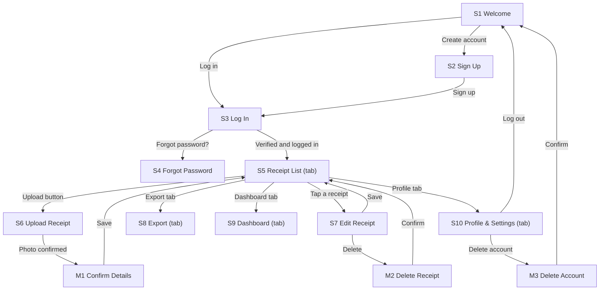

# IMPLEMENTATION_PLAN.md: SnapBooks

---

## 0. Plan details

| Field | Value |
| --- | --- |
| App name | SnapBooks |
| Built from PRD version | v1.2 (includes the v1.1 changes listed in `PRD_v1.1_changes.md`, applied to `docs/PRD.md`) |
| Screen designs | Stitch project: https://stitch.withgoogle.com/projects/10814477568114549475 ; exported PNGs in `docs/designs/` (one file per S# and M#: S1.png to S10.png and M1.png to M3.png) |
| Plan version | v1.2 |
| Repository | https://github.com/Paul280-cloud/snapbooks |
| Status | Ready to build |
| Last updated | 6 Nov 2026 |

---

## 1. Start here (instructions for the coding agent)

Before writing any code:

1. Read this whole file from top to bottom.
2. Read `docs/PRD.md`.
3. Look at the screen designs listed in Section 7.3.
4. Check Section 18. If any clarification is still **Open**, stop and ask the human. Do not start.
5. Check that the prerequisites in Section 4.2 are installed.
6. Start **Phase 1 only**. Follow Section 2 at all times.

---

## 2. Rules for the coding agent (copy word for word, do not edit)

1. **One phase at a time.** Only work on the phase the human asked for. When that phase's Definition of Done is complete, stop and wait for the human to say "Start Phase <number>".
2. **Test-driven development (TDD) for every task.** Follow the cycle in Section 12.1:
    - Write the test.
    - Run it and see it fail for the right reason.
    - Write the smallest code that makes it pass.
    - Run all tests.
    - Refactor while all tests still pass.
3. **Never cheat a test.** Never delete, skip, weaken or change a test just to make it pass. If you believe a test is wrong, stop and explain why to the human.
4. **Never break earlier work.** Every test from earlier phases must still pass before a phase is done.
5. **Build only what is planned.** Build only what is in this file and `docs/PRD.md`. Never build anything in Section 3.3 (Deferred).
6. **Ask, don't guess.** If anything is missing, unclear or contradictory, stop, add it to Section 18, and ask the human.
7. **Match the designs.** Every screen must match its design in Section 7.3: layout, order, labels, text, colours and spacing. Use the design tokens in Section 7.1. Never hard-code colours, font sizes or spacing.
8. **Every state, every screen.** Each screen must handle every state listed for it in Section 7.3 (chosen from normal, empty, loading, error, offline, success, plus any screen-specific states).
9. **Exact wording.** Use the exact labels and messages from the PRD. Never invent wording.
10. **Security first.**
    - Never put secret keys in app code, logs, test files or Git.
    - Every permission rule in Section 9 must be enforced on the server or database, never only in the app.
    - Every permission rule must have a test.
11. **Full check before "done".** Run the full check command (Section 4.3) before saying a phase is done, then add a short summary of the results to the Progress log (Section 17).
12. **Record your progress.** After each phase:
    - tick the checkboxes for that phase in this file;
    - add a row to the Progress log;
    - commit using the commit message given in the phase.
13. **No surprise libraries.** Do not add, remove or upgrade any library or tool not listed in Section 4.1 without asking the human first.
14. **Stuck rule.** If the same problem is still failing after 3 attempts, stop and report:
    - what you tried;
    - the exact error;
    - what you need from the human.
15. **Clean code.** Follow the folder structure in Section 5. Use the PRD's key terms (Section 3.4) for names in code. Keep files small and focused.

---

## 3. Project summary and scope

### 3.1 Summary

SnapBooks helps small South African business owners (spaza shops, market traders, freelancers) snap and file their receipts so that tax season stops being a nightmare. Users photograph a till slip, the app reads the vendor, amount, date and category where it can, and the user confirms or corrects the details. Receipts are kept in a searchable list that can be filtered by month or category, and exported as an .xlsx spreadsheet for SARS or an accountant.

**Platform:** Web app that works in a browser. Desktop-first at 1440px wide; also works on a phone at 360px.

### 3.2 Features in scope

| ID | Feature | Priority | Built in phase |
| --- | --- | --- | --- |
| F1 | Account | Must | 3 |
| F3 | Receipt list | Must | 4 |
| F2 | Upload receipt | Must | 5 |
| F4 | Edit and delete receipt | Must | 6 |
| F5 | Export | Must | 7 |
| F6 | Dashboard summary | Should | 8 |

F3 is built before F2 on purpose: the list (S5) is where users land after logging in and where a saved receipt appears, so it must exist before upload.

### 3.3 Deferred: do NOT build

- Automatic OCR with no human correction (the user must always confirm the details)
- Invoicing or quoting
- Accountant login, accountant view, share link, or any multi-user access
- Bank transaction import (Capitec, FNB)
- Native mobile app (iOS, Android, React Native)
- Income tracking and profit/loss summary
- Recurring expense reminders
- Notifications of any kind (all emails come from Supabase Auth only)
- Admin screens (admin work is done in the Supabase dashboard)
- Custom categories (the five categories are fixed)
- Changing email address, social log-in, or any sign-in method other than email and password
- Dark mode
- Onboarding screens
- Saving, deleting or exporting while offline
- Replacing the photo of a saved receipt (S7 edits the four text fields only)
- Automatic deletion of receipts (BR6)

### 3.4 Key terms (use these names in code)

| Term (PRD 1.7) | Name in code | Meaning |
| --- | --- | --- |
| Receipt | `Receipt`, table `receipts` | A single photo of a paper till-slip, with vendor, amount, date and category |
| Vendor | `vendor` | The business name printed on the receipt (e.g. "Pick n Pay"), 1 to 100 characters |
| Amount | `amount` | The total rand value, a decimal with exactly 2 places (e.g. R 149.00) |
| Category | `category`, type `Category` | Food, Stock, Fuel, Rent or Other |
| Export | `export` | One .xlsx file with all receipts for a chosen date range |
| Tax year | `taxYear`, function `taxYearFor` | 1 March to 28/29 February |
| Owner | `User`, table `users` | The only role: a person with an account |

---

## 4. Tech stack, prerequisites and commands

### 4.1 Stack

| Layer | Tool | Version | Used for |
| --- | --- | --- | --- |
| Frontend | React + Vite | Latest stable at setup | Web app screens |
| Routing | React Router | Latest stable at setup | Routes and redirects (Section 11) |
| Language | TypeScript (strict mode) | Bundled with the Vite template | All app, test and script code |
| Styling | Tailwind CSS | Latest stable at setup | Styling from the design tokens |
| Fonts | Inter (Google Fonts link in `index.html`) | n/a | Typography |
| Icons | lucide-react | Latest stable at setup | Outline icons |
| Photo reading (OCR) | tesseract.js | Latest stable at setup | Reads the receipt photo in the browser (OP9); nothing is sent to a server |
| Export | SheetJS Community Edition (`xlsx`) | Latest stable at setup; install it the way docs.sheetjs.com says | Builds the .xlsx file in the browser |
| Data fetching and caching | @tanstack/react-query | v5 | Loading states, retries, keeping the last list in memory |
| Backend client | @supabase/supabase-js | v2 | Talking to Supabase |
| Backend and database | Supabase: PostgreSQL, Auth, Storage | Supabase CLI latest | Data, log-in, private photo bucket |
| Server functions | Supabase Edge Functions | Supabase CLI latest | `delete-account` (needs the admin key) |
| Unit and component tests | Jest + ts-jest + jest-environment-jsdom + React Testing Library (with user-event and jest-dom) | Latest stable at setup | Rules, components, screens |
| Database and permission tests | pgTAP via `supabase test db` | Supabase CLI | Tables, triggers, RLS |
| Integration tests | Jest + supabase-js against the local Supabase | n/a | Operations OP1 to OP17 |
| End-to-end tests | Playwright (Chromium) | Latest stable at setup | User flows in a real browser, at 1440px and 360px |
| Lint and type check | ESLint (from the Vite template), TypeScript compiler | Bundled | Code quality |
| Secret scan | secretlint | Latest stable at setup | Finds keys committed by mistake (T-NFR-6) |
| Hosting | Vercel | n/a | Deploys the web app from GitHub |
| Runtime | Node.js | 24 LTS (the PRD said 20 LTS, which reached end of life in April 2026; see Section 18 #17) | Running tools |

Install packages with `npm install <package>`. Every version used is recorded in the Progress log (Section 17) after Phase 1.

### 4.2 Prerequisites on the computer

- [ ] Node.js 24 LTS and npm
- [ ] Git and a GitHub account
- [ ] Docker Desktop, running (the local Supabase needs it)
- [ ] Supabase CLI (run with `npx supabase`) and Playwright's browser (`npx playwright install chromium`)
- [ ] Accounts: Supabase (hosted project in Phase 10) and Vercel
- [ ] Five sample receipt photos (JPG or PNG, your own or free to use) saved in `supabase/seed/photos/` for the seed data, and one real till slip photo for manual OCR checks

### 4.3 Commands

| Purpose | Command |
| --- | --- |
| Install dependencies | `npm install` |
| Start the local backend | `npx supabase start` |
| Reset the database (migrations + seed rows) | `npx supabase db reset` then `npm run seed` (= `node --env-file=.env supabase/seed/seed.js`: sets seed passwords, uploads seed photos) |
| Serve the Edge Function locally | `npx supabase functions serve` |
| Start the app | `npm run dev` |
| Unit and component tests | `npm test` (= `jest --testPathIgnorePatterns tests/integration tests/e2e`) |
| Database and permission tests | `npx supabase test db` |
| Integration tests | `npm run test:integration` (= `node --env-file=.env node_modules/jest/bin/jest.js -c jest.integration.config.cjs`, node environment, folder `tests/integration`) |
| End-to-end tests | `npx playwright test` (the config starts the dev server) |
| Lint | `npm run lint` |
| Type check | `npm run typecheck` (= `tsc -b`) |
| **Full check (run before every "done")** | `npm run check` (runs lint, type check, `npm test`, `npx supabase test db`, `npm run test:integration`). Before running it: `npx supabase start` must be running, the database reset and seeded, and `npx supabase functions serve` running. |
| Build for release | `npm run build` |

End-to-end tests are not part of `npm run check`, because they need the dev server and the Edge Function running. Run them at the end of each feature phase (Step 4) and in Phases 9 and 10.

---

## 5. Folder structure

```
snapbooks/
  src/
    main.tsx                        App entry: providers (React Query, router)
    App.tsx                         Routes and redirect rules (Section 11)
    index.css                       Tailwind and the theme values from tokens.ts
    pages/                          One file per screen
      Welcome.tsx                   S1  /
      SignUp.tsx                    S2  /sign-up
      LogIn.tsx                     S3  /log-in
      ForgotPassword.tsx            S4  /forgot-password (request mode and set-new-password mode)
      ReceiptList.tsx               S5  /receipts
      UploadReceipt.tsx             S6  /receipts/new (M1 is shown on top of it)
      EditReceipt.tsx               S7  /receipts/:id (M2 is shown on top of it)
      Export.tsx                    S8  /export
      Dashboard.tsx                 S9  /dashboard
      Profile.tsx                   S10 /profile (M3 is shown on top of it)
    components/                     Shared components (Section 7.2)
    lib/
      supabase.ts                   Supabase client (public key only)
      api/                          One file per operation group (Section 10)
      rules/                        Pure business-rule functions (BR#), no network
      messages.ts                   Every user-facing message from the PRD, in one place
    hooks/                          useSession, useOnlineStatus
    theme/tokens.ts                 Design tokens (Section 7.1)
  public/
    privacy.html                    Privacy Notice (linked from S2 and S10)
    tesseract/                      Self-hosted OCR worker, core and English language data
  supabase/
    config.toml                     Local backend and Auth settings (Phase 3)
    migrations/                     SQL migrations (Section 8.6)
    functions/delete-account/       Edge Function (OP7)
    tests/                          pgTAP tests (T-DB, T-BR, T-SEC)
    seed.sql                        Seed rows: 4 users and their receipts (Section 8.7)
    seed/seed.js                    Sets seed passwords and uploads seed photos (uses the admin key; never in the app)
    seed/README.md                  How to run the seed script (no passwords in it)
    seed/photos/                    Sample receipt photos for the seed data
  tests/
    unit/                           T-BR, T-AUTH and other pure-function tests
    components/                     T-C and screen-state tests
    integration/                    Operation tests against the local backend
    e2e/                            Playwright flows
    fixtures/                       Sample OCR text and a sample receipt photo
  docs/PRD.md
  docs/designs/                     Exported designs: S1.png to S10.png, M1.png to M3.png
  jest.config.cjs
  jest.integration.config.cjs
  playwright.config.ts
  vercel.json                       Sends every route to index.html (single-page app)
  IMPLEMENTATION_PLAN.md
  .env.example
  .gitignore
  README.md
```

**Rule:** a new folder may only be created if it is added to this section first.

---

## 6. Environment variables and secrets

| Name | What it is | Where to get it | Public or secret | Used by |
| --- | --- | --- | --- | --- |
| `VITE_SUPABASE_URL` | Supabase project address | Local: `http://127.0.0.1:54321` (from `npx supabase status`). Hosted: Supabase dashboard, Project Settings | Public | App, seed script, integration tests |
| `VITE_SUPABASE_ANON_KEY` | Public (anon) key | Same | Public. Safe only because RLS is on for every table and the bucket has policies. | App |
| `SUPABASE_SERVICE_ROLE_KEY` | Admin (service role) key | Same | **Secret** | `supabase/seed/seed.js` and integration tests only. The Edge Function gets its own copy automatically from Supabase. |
| `SEED_TEST_PASSWORD` | One password for all four seed test accounts | You choose it | **Secret** | `supabase/seed/seed.js`, integration tests, Playwright |

`.env.example` (committed to Git, placeholder values only):

```
VITE_SUPABASE_URL=http://127.0.0.1:54321
VITE_SUPABASE_ANON_KEY=replace-with-anon-key
SUPABASE_SERVICE_ROLE_KEY=replace-with-service-role-key-never-commit
SEED_TEST_PASSWORD=replace-with-a-test-only-password
```

Rules:

- Real values go in `.env`, which is listed in `.gitignore` and never committed. Hosted values go in `.env.hosted`, also ignored.
- Only variables starting with `VITE_` may be used in `src/`. T-NFR-6 fails if `SERVICE_ROLE` appears in `src/`.
- Secret values are never used in app code. They are used only in the seed script, integration tests and the Edge Function (which reads its own copy from Supabase).
- If a new variable is needed, add it here and to `.env.example` first.

---

## 7. Design system and screens

### 7.1 Design tokens (`src/theme/tokens.ts`)

`tokens.ts` is the single source of truth. `src/index.css` declares the same values for Tailwind (use the method in Tailwind's documentation for the installed version). T-SETUP-1 fails if the two ever differ.

| Token | Value | From PRD |
| --- | --- | --- |
| `color.primary` | #1B7F4F | 9.1 Primary colour (white text on it passes 4.5:1) |
| `color.onPrimary` | #FFFFFF | 9.1 "white text on it" |
| `color.accent` | #F59E0B | 9.1 Secondary / accent (chart highlights, Fuel dot) |
| `color.background` | #F9FAFB | 9.1 |
| `color.text` | #111827 | 9.1 |
| `color.textSecondary` | #6B7280 | 9.1 (passes 4.5:1 on #F9FAFB) |
| `color.error` | #DC2626 | 9.1 |
| `color.success` | #16A34A | 9.1 |
| `color.warning` | #D97706 | 9.1 |
| `color.toastBackground` | same value as `color.text` (white text) | 8.3 Toast "dark background" |
| `color.category.fuel` | #F59E0B | 9.1 "Fuel category dot" |
| `color.category.food` / `stock` / `rent` / `other` | Take the hex values from the exported designs (`S5.png`), see Section 18 #18 | 8.2 S5 "category colour dot" |
| `font.family` | Inter (400, 600, 700) | 9.1 |
| `font.title` | 24px bold | 9.1 Text sizes |
| `font.heading` | 18px semibold | 9.1 |
| `font.body` | 16px regular | 9.1 |
| `font.small` | 13px regular | 9.1 |
| `space.1` / `space.2` / `space.3` / `space.4` / `space.5` | 4 / 8 / 16 / 24 / 32 px | 9.1 Spacing unit 8px, gaps 4, 8, 16, 24, 32 |
| `space.screen.mobile` / `space.screen.tablet` / `space.screen.desktop` | 16 / 32 / 24 px | 9.1 and 9.3 |
| `radius.card` / `radius.input` / `radius.button` | 8 / 6 / 6 px | 9.1 |
| `shadow.card` | 0 1px 3px rgba(0,0,0,0.1) | 9.1 Shadows |
| `size.button` | 48px | 9.1 Button height |
| `size.touchMin` | 44px | 9.4 |
| `size.contentMax` | 1200px | 9.3 |
| `bp.mobile` / `bp.desktop` | 640px / 1024px | 9.3 |
| `focus.ring` | 2px outline in `color.primary` | 9.3 |
| `hover.darken` | 10% | 9.3 |

### 7.2 Shared components

| Component | File | Variants and states | Used on | Tests |
| --- | --- | --- | --- | --- |
| Button | `components/Button.tsx` | primary, secondary (outlined), danger (red, white text); disabled (greyed out); loading (spinner, blocks presses); full width, 48px tall | All | T-C-1 |
| TextField | `components/TextField.tsx` | text, email, number, date, password with show/hide eye icon; normal, focused, error (red border and message under the field; keeps the user's text) | S2, S3, S4, S6, S7, S8 | T-C-2 |
| SelectField | `components/SelectField.tsx` | dropdown with label and placeholder; error | S5, S6, S7 | T-C-3 |
| Checkbox | `components/Checkbox.tsx` | unticked (default), ticked; label can contain a link | S2 | T-C-4 |
| Toast | `components/Toast.tsx` | one line, dark background, white text, disappears after 3 seconds | S5, S8 | T-C-5 |
| OfflineBanner | `components/OfflineBanner.tsx` | shown at the top when offline: "You're offline. Changes will not be saved." | All logged-in screens | T-C-6 |
| EmptyState | `components/EmptyState.tsx` | line illustration, centred message, optional button | S5, S8, S9 | T-C-7 |
| LoadingPlaceholder | `components/LoadingPlaceholder.tsx` | grey placeholder cards or bars | S5, S9 | T-C-8 |
| ConfirmModal | `components/ConfirmModal.tsx` | title, text, secondary and primary or danger buttons; closes with Escape | M1, M2, M3 | T-C-9 |
| Header | `components/Header.tsx` | back arrow (where applicable) and page title; S5 variant: wordmark left and receipt count right | S2 to S10 | T-C-10 |
| TabBar | `components/TabBar.tsx` | 4 tabs in order: Receipts, Export, Dashboard, Profile (Lucide icons); active tab in primary colour; bottom bar below 1024px, top navigation bar at 1024px and above (Section 18 #12) | S5, S8, S9, S10 | T-C-11 |
| ReceiptCard | `components/ReceiptCard.tsx` | category colour dot, vendor (bold), date (12 Mar 2026), amount right-aligned (R 149.00), category label; tap opens S7 | S5 | T-C-12 |
| ReceiptForm | `components/ReceiptForm.tsx` | the four fields Vendor, Amount, Date, Category with the exact placeholders and error messages from PRD S6; Save disabled until valid | S6, S7 | T-C-13 |
| BarChart | `components/BarChart.tsx` | simple SVG bars drawn by the app (no chart library), each bar labelled with text and rand value; empty and loading | S9 | T-C-14 |

### 7.3 Screens

| ID | Screen | Route / file | Design | Who can open it (else redirect to) | Tab bar | Required states | Phase |
| --- | --- | --- | --- | --- | --- | --- | --- |
| S1 | Welcome | `/` (`src/pages/Welcome.tsx`) | `docs/designs/S1.png` | Logged out (else S5) | No | Normal | 1 |
| S2 | Sign Up | `/sign-up` (`SignUp.tsx`) | `S2.png` | Logged out (else S5) | No | Normal, Error, Loading, Success | 3 |
| S3 | Log In | `/log-in` (`LogIn.tsx`) | `S3.png` | Logged out (else S5) | No | Normal, Error, Locked, Unverified (and the verify-email banner) | 3 |
| S4 | Forgot Password | `/forgot-password` (`ForgotPassword.tsx`) | `S4.png` (the set-new-password mode reuses the same layout with one password field, see Section 18 #6) | Logged out, or opened from the reset email link (else S5) | No | Normal, Success (both modes), Error (set-new-password mode: password rule) | 3 |
| S5 | Receipt List | `/receipts` (`ReceiptList.tsx`) | `S5.png` | Logged in (else S1) | Yes | Normal, Empty, Filtered empty, Loading, Loading more, Error, Offline, Limit reached (BR4) | 3 (placeholder), 4 |
| S6 | Upload Receipt | `/receipts/new` (`UploadReceipt.tsx`) | `S6.png` | Logged in (else S1) | No | Normal (pre-filled), Manual, Error, Uploading, Offline | 5 |
| S7 | Edit Receipt | `/receipts/:id` (`EditReceipt.tsx`) | `S7.png` | Logged in, own receipt only (else S5 with "This receipt is no longer available.") | No | Normal, Error, Saving, Success, Offline, Not available. The Manual and Uploading states of S6 do not apply (Section 18 #19). | 6 |
| S8 | Export | `/export` (`Export.tsx`) | `S8.png` | Logged in (else S1) | Yes | Normal, Empty range, Exporting, Success, Offline | 3 (placeholder), 7 |
| S9 | Dashboard | `/dashboard` (`Dashboard.tsx`) | `S9.png` | Logged in (else S1) | Yes | Normal, Empty, Loading | 3 (placeholder), 8 |
| S10 | Profile & Settings | `/profile` (`Profile.tsx`) | `S10.png` | Logged in (else S1) | Yes | Normal | 3 |
| M1 | Confirm Receipt Details | Modal on S6 (`ConfirmModal`) | `M1.png` | Logged in (from S6) | n/a | Normal | 5 |
| M2 | Delete Receipt | Modal on S7 (`ConfirmModal`) | `M2.png` | Logged in (from S7) | n/a | Normal | 6 |
| M3 | Delete Account | Modal on S10 (`ConfirmModal`) | `M3.png` | Logged in (from S10) | n/a | Normal | 3 |

The Privacy Notice is not a screen. It is the static page `public/privacy.html`, served at `/privacy` and linked from S2 and S10 (Section 18 #16).

---

## 8. Data model and database

All tables live in the `public` schema. `users.id` is the same as the Supabase Auth user id. "Cascade" means the row is deleted when the row it points to is deleted.

### 8.1 Tables

**Table: `users`**: one person's profile.

| Column | Type | Null? | Default | Constraints | Notes |
| --- | --- | --- | --- | --- | --- |
| id | uuid | No | — | primary key; foreign key → `auth.users.id` on delete cascade | Created by trigger `handle_new_user` |
| email | text | No | — | unique; check `email = lower(email)` | Managed by Supabase Auth; this copy is never readable by other users (SEC1) |
| display_name | text | Yes | — | check `char_length(display_name) between 1 and 60` | Read-only in the app in v1 (Section 18 #4) |
| is_18_or_older | boolean | No | false | check `is_18_or_older = true` | From the sign-up checkbox (PRD 5) |
| created_at | timestamptz | No | now() | | |

**Table: `receipts`**: one saved expense.

| Column | Type | Null? | Default | Constraints | Notes |
| --- | --- | --- | --- | --- | --- |
| id | uuid | No | gen_random_uuid() | primary key | The app creates the id before upload so the photo path can use it (OP11) |
| owner_id | uuid | No | auth.uid() | foreign key → `users.id` on delete cascade | SEC5 |
| photo_url | text | No | — | check `char_length(photo_url) <= 500` | Holds the path `{owner_id}/{id}.{jpg\|png\|webp}` in the private bucket `receipts`, not a public link (Section 18 #11) |
| vendor | text | No | — | check `char_length(btrim(vendor)) between 1 and 100` | BR1 |
| amount | numeric(12,2) | No | — | check `amount > 0 and amount <= 999999.99` | BR1, BR7 |
| date | date | No | — | not in the future: trigger `validate_receipt_date` (a CHECK cannot use today's date safely) | BR1 |
| category | text | No | — | check `category in ('Food','Stock','Fuel','Rent','Other')` | BR1, BR2 |
| created_at | timestamptz | No | now() | | |
| updated_at | timestamptz | No | now() | | Set by trigger `set_updated_at` on every edit |

### 8.2 Relationships and delete behaviour

- One user owns many receipts. Deleting a user (`auth.users` row) cascades to `users`, then to `receipts` (PRD 10.2).
- A database cascade does not delete files in Storage. The Edge Function `delete-account` (OP7) removes the user's folder in the `receipts` bucket first, then deletes the Auth user (Section 18 #3).
- Deleting a single receipt (OP15) deletes the row, then removes its photo from the bucket.
- Nothing deletes a receipt automatically (BR6).

### 8.3 Status changes

None in v1. Receipts have no workflow state (PRD 10.3).

### 8.4 Indexes

- `receipts (owner_id, date desc, created_at desc)`: receipt list (newest first), month filter, export, dashboard totals
- `receipts (owner_id, category)`: category filter

Search by vendor (`ilike`) scans at most 500 rows per user (BR4), so it needs no index.

### 8.5 Automatic jobs and triggers

| Name | Runs when | What it does | BR# | Test |
| --- | --- | --- | --- | --- |
| `handle_new_user` | After insert on `auth.users` | Creates the `users` row with the lower-cased email, `is_18_or_older` and optional `display_name` from the sign-up metadata. Security definer. | PRD 5 | T-DB-1 |
| `set_updated_at` | Before update on `receipts` | Sets `updated_at = now()` | PRD 10.1 | T-DB-2 |
| `limit_receipts` | Before insert on `receipts` | Takes an advisory lock for the owner, counts the owner's receipts and raises `receipt_limit_reached` if the owner already has 500 | BR4 | T-BR4-1 |
| `validate_receipt_date` | Before insert or update of `date` on `receipts` | Raises `receipt_date_in_future` if the date is after today in South African time (SAST) | BR1 | T-BR1-3 |

There are no scheduled jobs in v1 (PRD 11.1). T-BR6-1 proves nothing deletes receipts on its own.

### 8.6 Migrations (in order)

1. `0001_tables.sql`: `users`, `receipts`, constraints and indexes from 8.1 and 8.4
2. `0002_triggers.sql`: the four functions and triggers from 8.5 (every function sets `search_path = ''`)
3. `0003_rls.sql`: RLS switched on for every table; policies, privileges and column grants from Section 9 (SEC1 to SEC7, SEC11)
4. `0004_storage.sql`: private bucket `receipts` (file size limit 10 485 759 bytes, which is under 10 MB; JPG, PNG and WebP only) and storage policies (SEC8 to SEC10)

### 8.7 Seed data and test accounts

- **`supabase/seed.sql`** runs automatically on `npx supabase db reset`. It inserts the four users from PRD 8.4 into `auth.users` (confirmed email, fixed id, `raw_user_meta_data` with `is_18_or_older: true` and the display name) so `handle_new_user` creates their profiles. It then inserts their receipts, using photo paths like `{user id}/seed-{n}.jpg`.
- **Fixed seed user ids** (so database tests can act as each user): Zanele `00000000-0000-0000-0000-000000000001`, Mpho `…0002`, Thabo `…0003`, Ayesha `…0004`.
- **Receipt counts:** Zanele 14, Mpho 9, Thabo 1, Ayesha 0. Zanele's first five are the sample receipts in PRD 8.4 (Pick n Pay 12 Mar 2026 R 320.00 Stock; BP Fuels 8 Mar 2026 R 780.00 Fuel; Shoprite 1 Mar 2026 R 215.50 Food; Game Stores 15 Feb 2026 R 1 200.00 Stock; Total Garage 20 Jan 2026 R 650.00 Fuel). Her other nine are dated between 1 Mar 2025 and 14 Jan 2026, mostly Stock and Fuel. Mpho's nine are all dated between 1 Mar 2025 and 28 Feb 2026, mostly Fuel and Other. Thabo's one receipt is Shoprite, 3 Mar 2026, R 89.99, Food. Tests depend only on these counts, dates and the five named receipts, never on the other values.
- **`supabase/seed/seed.js`** (run with `npm run seed`, safe to run again) sets every seed user's password to `SEED_TEST_PASSWORD` and uploads the sample photos from `supabase/seed/photos/` to the paths used in `seed.sql`.
- **Test accounts:** zanele.d@example.com (receipts, use for the demo), mpho.s@example.com (use for export), thabo.m@example.com (one receipt, near-empty states), ayesha.p@example.com (no receipts, empty states). The password comes from `SEED_TEST_PASSWORD`. It is never written in any file in Git (Section 18 #21).

---

## 9. Security and permissions

Every rule below is enforced by the database or Storage, never only by hiding things on screen.

| ID | Table / resource | Action | Who is allowed | Rule | Enforced by | Tests (allow / deny) |
| --- | --- | --- | --- | --- | --- | --- |
| SEC1 | `users` | read | Owner | Own row only (`id = auth.uid()`). Nobody reads another user's row or email. | RLS select policy `users_select_own` | T-SEC-1a / T-SEC-1b |
| SEC2 | `users` | update | Owner | Own row only. Only `display_name` can change; `id`, `email`, `is_18_or_older` and `created_at` cannot. | RLS update policy + column privilege (`grant update (display_name)`) | T-SEC-2a / T-SEC-2b |
| SEC3 | `users` | delete | Owner | Own account only, through the Edge Function `delete-account`. Clients have no delete policy. The function takes the user from the request token and ignores any id in the request. | Edge Function code | T-SEC-3a / T-SEC-3b |
| SEC4 | `receipts` | read | Owner | `owner_id = auth.uid()` | RLS select policy `receipts_select_own` | T-SEC-4a / T-SEC-4b |
| SEC5 | `receipts` | create | Owner | `owner_id = auth.uid()`; at most 500 receipts per user (BR4) | RLS insert policy + trigger `limit_receipts` | T-SEC-5a / T-SEC-5b |
| SEC6 | `receipts` | update | Owner | `owner_id = auth.uid()`. Only `vendor`, `amount`, `date` and `category` can change. | RLS update policy + column privilege | T-SEC-6a / T-SEC-6b |
| SEC7 | `receipts` | delete | Owner | `owner_id = auth.uid()` | RLS delete policy | T-SEC-7a / T-SEC-7b |
| SEC8 | Storage bucket `receipts` | upload | Owner | The file path must start with the user's own id (`(storage.foldername(name))[1] = auth.uid()::text`). JPG, PNG or WebP, under 10 MB (BR3): a file of exactly 10 MB (10 485 760 bytes) is rejected. | Storage insert policy + bucket size and type limits | T-SEC-8a / T-SEC-8b |
| SEC9 | Storage bucket `receipts` | read | Owner | Path must start with the user's own id. Photos are shown through short-lived signed links. | Storage select policy | T-SEC-9a / T-SEC-9b |
| SEC10 | Storage bucket `receipts` | delete | Owner | Path must start with the user's own id | Storage delete policy | T-SEC-10a / T-SEC-10b |
| SEC11 | All tables and the bucket | any | Nobody who is logged out | The `anon` role has no access to anything | Privileges revoked from `anon`; no policy for `anon` | T-SEC-11b (deny only) |

**Always-on security checks** (tested in Phase 2 and Phase 9):

- [ ] Every table in `public` has RLS switched on. T-DB-6 fails if any table has it off.
- [ ] Input is checked in the app (`src/lib/rules/`) **and** in the database (constraints and triggers in Section 8).
- [ ] The 500-receipt limit (BR4) is enforced by a database trigger, not only by disabling the button. Sign-in attempts are limited by Supabase Auth's own rate limit (Section 18 #7).
- [ ] File uploads are checked in the app (BR3) and again by the bucket's size and type limits (SEC8). T-BR3-2.
- [ ] No passwords, tokens or personal data are written to logs (T-NFR-7).
- [ ] A secret scan of the repository finds no keys (T-NFR-6).

---

## 10. Backend operations

All operations live in `src/lib/api/`. Each returns either data or one of the exact messages in `src/lib/messages.ts`. Raw Supabase errors are never shown to the user. If an error code below does not match what Supabase really returns, stop and ask (Rule 6).

| ID | Operation | Who can call it | Input | Output | Rules | Errors (exact message) | Built as | Tests |
| --- | --- | --- | --- | --- | --- | --- | --- | --- |
| OP1 | Sign up | Anyone logged out | email, password, is18, agreedPrivacy | Account created; verification email sent; user goes to S3 with the verify banner | PRD 5, T-AUTH-1 | "This email already has an account. Log in instead?" (with a "Log in" link); "Enter a valid email address."; "At least 8 characters, including a number." | Supabase Auth `signUp` with `options.data = { is_18_or_older: true }` and `emailRedirectTo` = the site's `/log-in`. Supabase may return no error for an email that already exists (to avoid revealing accounts) and instead return a user with an empty `identities` list. Treat both as "already has an account". | T-US1-1, T-US1-2, T-US1-3 |
| OP2 | Log in | Anyone logged out | email, password | Session | PRD 5 | "Please verify your email first." (with "Resend email"); "Too many attempts. Try again in 15 minutes."; "Incorrect email or password." | Auth `signInWithPassword`. Map `email_not_confirmed`, `over_request_rate_limit` and `invalid_credentials`. | T-US2-1, T-US2-2, T-AUTH-2, T-S3-1 |
| OP3 | Resend verification email | Anyone logged out | email | A new verification email | PRD 5 | "Something went wrong. Try again." | Auth `resend({ type: 'signup', email })`. Success text: "Verification email sent." (Section 18 #6) | T-S3-2 |
| OP4 | Request password reset | Anyone | email | Always the same message | Never reveals whether an account exists | "If an account exists for this email, we've sent a reset link." (shown for every email) | Auth `resetPasswordForEmail` with `redirectTo` = the site's `/forgot-password` | T-US2-3, T-S4-1 |
| OP5 | Set new password | User who opened the reset link | new password | Password changed; user logged in; goes to S5 | T-AUTH-1 | "At least 8 characters, including a number." | S4 reads the recovery session from the link, then Auth `updateUser({ password })` | T-US2-4 |
| OP6 | Log out | Logged in | none | Session ended; user goes to S1 | PRD 5 (no confirmation) | none | Auth `signOut` | T-INT-1, T-S10-1 |
| OP7 | Delete account | Logged in (own account) | none | Receipts, photos, profile and Auth user deleted; user goes to S1 | PRD 5, SEC3 | "Something went wrong. Try again." | Edge Function `delete-account`: gets the caller from the request token, removes every file in `receipts/{user id}/`, then deletes the Auth user (cascade deletes the rest) | T-INT-2, T-SEC-3a, T-SEC-3b, T-M3-1 |
| OP8 | Get my profile | Logged in | none | display_name (may be empty) and the email from the session | SEC1 | "Something went wrong. Try again." | Select own row from `users`; email from `supabase.auth.getUser()` | T-S10-1, T-SEC-1a |
| OP9 | Read receipt photo | Logged in | image file | vendor, amount, date, category: each may be empty | BR8 | When nothing can be read: "We couldn't read a receipt from that photo. Enter the details manually." (shown on S6 in the Manual state, not an error) | Tesseract.js in the browser with self-hosted assets from `public/tesseract/`, then `parseReceiptText` in `src/lib/rules/receiptReader.ts`. No photo or text leaves the browser. | T-BR8-1 to T-BR8-4, T-US3-1, T-EDGE-5 |
| OP10 | Upload receipt photo | Logged in | file, receipt id | Storage path | BR3, SEC8 | "This file can't be used. Choose a JPG, PNG or WebP under 10 MB."; "Upload failed. Check your connection."; "You're offline. Receipts can't be saved without a connection." | Storage upload to `receipts/{user id}/{receipt id}.{jpg\|png\|webp}`, no overwrite | T-US3-2, T-US3-3, T-BR3-1, T-BR3-2, T-EDGE-2 |
| OP11 | Create receipt | Logged in | receipt id, vendor, amount, date, category, photo path | The saved receipt | BR1, BR2, BR4, BR7 | "Enter a vendor name."; "Enter a rand amount, e.g. 89.99."; "Enter a date that is not in the future."; "Select a category."; "You've reached the 500-receipt limit for this account." | Table insert with the id made by the app (`crypto.randomUUID()`). If the insert fails, remove the uploaded photo. Map database errors `receipt_limit_reached` and `receipt_date_in_future` to the messages. | T-US3-4, T-BR1-1, T-BR1-3, T-BR4-1, T-INT-4, T-EDGE-3 |
| OP12 | List receipts | Logged in | search text, category, month, page | 20 receipts per page and the user's total receipt count | Newest first (Section 18 #9), BR2, BR4 | "Something went wrong. Try again." | Select own receipts with `ilike` on vendor, category and month filters, `range` for 20 per page, exact count | T-US4-1, T-US4-2, T-INT-3 |
| OP13 | Get receipt | Logged in | receipt id | The receipt and a signed photo link valid for 1 hour | SEC4, SEC9 | "This receipt is no longer available." | Select one row, then `createSignedUrl` | T-EDGE-1, T-INT-5 |
| OP14 | Update receipt | Owner | receipt id, vendor, amount, date, category | The updated receipt | BR1, BR2, BR7, SEC6 | Same field messages as OP11; "This receipt is no longer available." if the row is gone; "Please log in again." if the session expired | Table update of the four fields | T-US5-1, T-US5-2, T-EDGE-1, T-EDGE-4 |
| OP15 | Delete receipt | Owner | receipt id | Receipt and its photo removed | BR6, SEC7, SEC10 | "Couldn't delete. Check your connection." | Delete the row, then remove the file from the bucket | T-US6-1, T-US6-2, T-INT-5 |
| OP16 | Export receipts | Logged in | start date, end date | A downloaded .xlsx file | BR5, BR7 | "No receipts in that range. Adjust the dates and try again." | Select own receipts in the range, then build the file with SheetJS in the browser | T-BR5-1 to T-BR5-3, T-US7-1, T-US7-2, T-INT-6 |
| OP17 | Get dashboard totals | Logged in | none (uses the current tax year) | Total per category, total per month (March to February), grand total | BR2, BR7 | "No data yet. Upload receipts to see your spending summary." (empty state); "Something went wrong. Try again." | Select date, amount and category for the current tax year, then add up in whole cents in the app | T-US8-1, T-US8-2, T-BR7-4, T-INT-7 |

---

## 11. Navigation rules

- **Logged out:** can only open S1, S2, S3, S4 and `/privacy`. Any other route goes to S1.
- **Logged in:** opening S1, S2 or S3 goes to S5. S4 is only allowed while the user arrived from a reset email link (the set-new-password mode); otherwise it goes to S5.
- **Unknown routes:** go to S1 when logged out and to S5 when logged in.
- **Choosing a photo:** the "+ Upload receipt" button on S5 opens the file picker, and the chosen file is passed to S6 in memory. Opening `/receipts/new` with no chosen photo goes to S5 (Section 18 #22).
- **Login expired while using the app:** show "Please log in again." and go to S3. Unsaved edits are lost (PRD 6.2).
- **Tabs:** Receipts (S5), Export (S8), Dashboard (S9), Profile (S10). The tab bar is hidden on S1, S2, S3, S4, S6 and S7. Tapping the active tab scrolls to the top.
- **Back button:** the back arrow in the header returns to the previous screen. On S6 and S7 it cancels and goes to S5. Modals close with Cancel, the Escape key or the browser back button. The browser back button works normally everywhere else.
- **Email links:** the verification link opens `/log-in` (S3). If Supabase signs the user in from that link, the logged-in rule above sends them to S5. The reset link opens `/forgot-password` (S4) in set-new-password mode (Section 18 #6).
- **Navigation map** (copied from PRD 7.2; S4 also opens from the reset email link):



---

## 12. Testing strategy

### 12.1 The TDD cycle (every task, every phase)

1. **Red:** write one test for the behaviour, using the acceptance criterion or rule. Run it. It must **fail**, and fail for the expected reason (e.g. "screen not found", not "syntax error").
2. **Green:** write the **smallest** amount of code that makes that test pass. Run **all** tests.
3. **Refactor:** clean up names, remove duplication, move code to the right folder. Run all tests again. They must still pass.
4. Repeat for the next test.

### 12.2 Test levels

| Level | What it proves | Tool | Folder | Command |
| --- | --- | --- | --- | --- |
| Unit | Business rules and helper functions in `src/lib/rules/` give the right answers | Jest + ts-jest | `tests/unit/` | `npm test` |
| Component | Each component and screen shows the right things in every state, with fake data and `src/lib/api` mocked | Jest + React Testing Library (jsdom) | `tests/components/` | `npm test` |
| Database and permissions | Constraints, triggers and permission rules allow and deny the right people | pgTAP | `supabase/tests/` | `npx supabase test db` |
| Integration | Each backend operation works against the real local backend | Jest + supabase-js (node) | `tests/integration/` | `npm run test:integration` |
| End-to-end | Whole user flows from PRD 7.1 work in a real browser | Playwright (Chromium, 1440px and 360px) | `tests/e2e/` | `npx playwright test` |
| Manual | Screens match the designs; real-device and real-browser checks | Human | Step 5 of each phase | none |

### 12.3 Test IDs

Every automated test name starts with its ID, for example `it('T-US1-2 shows the already-registered message', ...)`. Run one test with `npm test -- -t "T-US1-2"`.

| Prefix | Comes from | Example |
| --- | --- | --- |
| T-SETUP-# | Phase 1 tool and setup checks | T-SETUP-1 |
| T-US#-# | PRD acceptance criteria (Section 6) | T-US1-2 |
| T-AUTH-# | Account rules (PRD Section 5) | T-AUTH-1 |
| T-BR#-# | Business rules (PRD 4.4 and BR8) | T-BR1-1 |
| T-SEC-#a / b | Permission rules (Section 9), allow / deny | T-SEC-4b |
| T-DB-# | Database constraints and triggers not covered by a BR | T-DB-2 |
| T-INT-# | Backend operations not covered by a T-US test (Section 10) | T-INT-3 |
| T-C-# | Shared components (Section 7.2) | T-C-12 |
| T-S#-# / T-M#-# | Extra states or behaviour of one screen or modal | T-S5-1 |
| T-NAV-# | Navigation rules (Section 11) | T-NAV-1 |
| T-EDGE-# | Edge cases (PRD 6.2) | T-EDGE-2 |
| T-E2E-# | User flows (PRD 7.1) | T-E2E-1 |
| T-NFR-# | Quality requirements (PRD 12.1) | T-NFR-3 |
| T-REL-# | Release checks (Phase 10) | T-REL-1 |

The same ID may be used at two levels when both prove the same criterion, e.g. T-US1-1 as a component test and as an integration test.

### 12.4 Test data rules

- Tests never depend on each other or on the order they run in.
- pgTAP tests run inside a transaction and roll back, and start from the seed data. To act as a seed user: `set local role authenticated; select set_config('request.jwt.claims', json_build_object('sub', '00000000-0000-0000-0000-000000000001', 'role', 'authenticated')::text, true);` (that id is Zanele).
- Integration tests create their own users with random emails and delete them at the end.
- Playwright tests reset and reseed the database before the run (`npx supabase db reset` then `npm run seed`).
- Component tests use the PRD 8.4 sample data (Zanele, Mpho, Thabo, Ayesha) as fake data and never make real network calls. Tests that depend on "today" set a fixed date.
- OCR is never run in unit or component tests. They use sample OCR text from `tests/fixtures/`. Only manual checks and the Playwright upload flow run the real reader.
- No real personal data or real passwords are used anywhere in tests.

### 12.5 Coverage rules

- 100% of PRD acceptance criteria (T-US…) have an automated test, or a manual check where automation is not possible (marked "manual").
- 100% of business rules (BR1 to BR8) have unit or database tests.
- 100% of permission rules (SEC1 to SEC10) have an allow test and a deny test. SEC11 has a deny test only.
- 100% of PRD edge cases (T-EDGE-1 to T-EDGE-6) have a test.
- At least 90% line coverage for `src/lib/rules/`.

---

## 13. Phases

### 13.0 Phase overview

| Phase | Name | Features | Screens | Main tests |
| --- | --- | --- | --- | --- |
| 1 | Foundation | none | S1 | T-SETUP-1 to 4, T-C-1 to 9, T-S1-1 |
| 2 | Data and security | none | none | T-DB-1 to 6, T-BR1-3, T-BR2-2, T-BR4-1, T-BR6-1, T-BR7-3, T-SEC-1 to 11 |
| 3 | Accounts | F1 | S2, S3, S4, S10, M3 (S5, S8, S9 as placeholders) | T-US1, T-US2, T-AUTH-1 to 3, T-C-10, T-C-11, T-NAV-1, T-INT-1, T-INT-2, T-SEC-3 |
| 4 | Receipt list | F3 | S5 | T-US4, T-BR2-1, T-BR2-3, T-BR4-2, T-BR7-1, T-C-12, T-EDGE-6 |
| 5 | Upload receipt | F2 | S6, M1 | T-US3, T-BR1-1, T-BR1-2, T-BR3, T-BR7-2, T-BR8, T-C-13, T-EDGE-2, 3, 5 |
| 6 | Edit and delete receipt | F4 | S7, M2 | T-US5, T-US6, T-BR6-2, T-EDGE-1, T-EDGE-4 |
| 7 | Export | F5 | S8 | T-US7, T-BR5, T-S8 |
| 8 | Dashboard summary | F6 | S9 | T-US8, T-BR7-4, T-S9, T-C-14 |
| 9 | Hardening | none | All | T-NFR-1 to 12, T-DB-6, T-E2E-1 to 5 |
| 10 | Release | none | All | T-REL-1 to 3 |

---

### Phase 1: Foundation

**Goal:** The app opens on S1 Welcome, matching its design, and every test level has one passing example test.

**Covers:** Screens S1 · Components Button, TextField, SelectField, Checkbox, Toast, OfflineBanner, EmptyState, LoadingPlaceholder, ConfirmModal

**Starts when:** All of Section 18 is Answered and the human says "Start Phase 1".

**Step 1: Write the failing tests first (Red)**

| Test ID | Level | File | What it checks |
| --- | --- | --- | --- |
| T-SETUP-1 | Unit | `tests/unit/tokens.test.ts` | Every value in `tokens.ts` matches Section 7.1 (e.g. `color.primary` is #1B7F4F), and `index.css` declares the same values |
| T-C-1 | Component | `tests/components/Button.test.tsx` | Primary, secondary and danger render; a disabled button cannot be pressed; loading shows a spinner and blocks presses; height is 48px; a focus ring shows on keyboard focus |
| T-C-2 | Component | `TextField.test.tsx` | Shows the error message and red border; keeps the typed text; the password eye icon toggles visibility and has an accessible label |
| T-C-3 | Component | `SelectField.test.tsx` | Shows its options and the chosen value; shows an error message |
| T-C-4 | Component | `Checkbox.test.tsx` | Unticked by default; toggles on click; a link inside the label opens without toggling the box |
| T-C-5 | Component | `Toast.test.tsx` | Shows the text, then disappears after 3 seconds |
| T-C-6 | Component | `OfflineBanner.test.tsx` | Visible with the exact text "You're offline. Changes will not be saved." when offline; hidden when online |
| T-C-7 | Component | `EmptyState.test.tsx` | Shows the message and an optional button that calls its action |
| T-C-8 | Component | `LoadingPlaceholder.test.tsx` | Renders grey placeholder cards and grey placeholder bars |
| T-C-9 | Component | `ConfirmModal.test.tsx` | Shows title and text; the confirm button calls confirm; Cancel and the Escape key call cancel |
| T-S1-1 | Component | `tests/components/Welcome.test.tsx` | S1 shows the "SnapBooks" wordmark with a camera icon, the tagline "Snap receipts. Survive tax season.", the button "Create account" (to `/sign-up`) and the link "Log in" (to `/log-in`) |
| T-SETUP-2 | Database | `supabase/tests/000_setup.test.sql` | pgTAP runs: `select has_schema('public')` passes |
| T-SETUP-3 | Integration | `tests/integration/health.test.ts` | The app's Supabase client connects to the local backend |
| T-SETUP-4 | End-to-end | `tests/e2e/00_launch.spec.ts` | `/` opens at 1440px and at 360px and shows "Create account" |

- [x] All tests above are written, run, and fail for the expected reason.

**Step 2: Backend (Green)**

- [x] `npx supabase init`; `npx supabase start` works. (`supabase start` requires Docker — blocked on this machine; `supabase init` passed.)
- [x] `src/lib/supabase.ts` creates the client from the `VITE_` variables only.

**Step 3: Frontend (Green)**

- [x] Create the Vite React TypeScript app (strict mode). Add every library in Section 4.1. Add the scripts `check`, `typecheck`, `test:integration` and `seed`, plus the Jest and Playwright configs.
- [x] `src/theme/tokens.ts` with every token in 7.1, and `src/index.css` using the same values.
- [x] Build the nine components in 7.2 listed above (T-C-1 to T-C-9).
- [x] Build S1 Welcome to `docs/designs/S1.png`.
- [x] Add `.env.example`, `.gitignore` (includes `.env` and `.env.hosted`), `vercel.json` and a README with setup steps.

**Step 4: Refactor and full check**

- [x] Code cleaned up; names use PRD key terms.
- [x] `npm run check` passes (lint ✓ typecheck ✓ npm test 60/60 ✓; `npx supabase test db` and `npm run test:integration` blocked by Docker). `npx playwright test tests/e2e/00_launch.spec.ts` passes (4/4).

**Step 5: Manual checks (human)**

- [ ] S1 in a real browser at 1440px and at 360px matches `S1.png` side by side, and Inter is loading.
- [ ] `.env` is not shown by `git status`.

**Definition of Done**

- [x] Every test in Step 1 passes. (T-SETUP-2 and T-SETUP-3 require Docker — noted in Progress log.)
- [x] Exact installed versions are recorded in the Progress log.
- [x] Every screen in this phase shows all its required states.
- [ ] Manual checks are ticked by the human.
- [x] Progress log updated (Section 17).

**Commit message:** `Phase 1: Foundation`

**STOP.** Wait for the human to say "Start Phase 2".

---

### Phase 2: Data and security

**Goal:** The whole database exists with every rule, trigger and permission enforced and tested, and the seed data loads with two commands.

**Covers:** Section 8 (all) · Section 9 SEC1 to SEC11 (SEC3 is tested in Phase 3) · Rules BR1, BR2, BR4, BR6, BR7 (database parts)

**Starts when:** Phase 1 is complete and the human says "Start Phase 2".

**Step 1: Write the failing tests first (Red)**

All tests in this phase are pgTAP tests in `supabase/tests/`.

| Test ID | Level | File | What it checks |
| --- | --- | --- | --- |
| T-DB-1 | Database | `010_tables.test.sql` | Every table and column in 8.1 exists with the right type, null rule and default. Inserting an `auth.users` row with sign-up metadata creates a `users` row with a lower-case email. |
| T-DB-2 | Database | `020_triggers.test.sql` | Updating a receipt changes `updated_at` and leaves `created_at` alone |
| T-DB-3 | Database | `020_triggers.test.sql` | A `users` row with `is_18_or_older` false is rejected |
| T-DB-4 | Database | `010_tables.test.sql` | Deleting an `auth.users` row deletes its `users` row and all its receipts |
| T-DB-5 | Database | `010_tables.test.sql` | Both indexes in 8.4 exist |
| T-BR1-3 | Database | `030_rules.test.sql` | Vendor "", "   " and 101 characters are rejected; 1 and 100 characters are accepted. Amount 0, -1 and 1000000 are rejected; 0.01 and 999999.99 are accepted. A date of tomorrow (SAST) raises `receipt_date_in_future`; today is accepted. A missing field is rejected. |
| T-BR2-2 | Database | `030_rules.test.sql` | Category "Travel" is rejected; Food, Stock, Fuel, Rent and Other are accepted |
| T-BR4-1 | Database | `030_rules.test.sql` | The 500th receipt is accepted; the 501st raises `receipt_limit_reached`; a different user can still insert |
| T-BR6-1 | Database | `030_rules.test.sql` | No scheduled job exists (pg_cron is not installed) and no trigger on `receipts` deletes anything |
| T-BR7-3 | Database | `030_rules.test.sql` | A negative amount is rejected; an amount of 149 is read back as 149.00 |
| T-DB-6 | Database | `080_rls_all.test.sql` | Every table in `public` has RLS switched on |
| T-SEC-1a to T-SEC-11b | Database | `040_rls_users.test.sql`, `050_rls_receipts.test.sql`, `060_storage.test.sql` | One allow and one deny test per row in Section 9 (SEC11 has deny only), acting as Zanele and Mpho. Storage tests here check the folder rules only; size and type limits are tested in Phase 5 (T-BR3-2). SEC3 is tested in Phase 3. |

- [x] All tests above are written. (Execution requires Docker — blocked on this machine.)

**Step 2: Backend (Green)**

- [x] Migrations `0001` to `0004` exactly as in Section 8.6, written and ready for `npx supabase db reset`.
- [x] `supabase/seed.sql`, `supabase/seed/seed.js` and `supabase/seed/README.md` written.

**Step 3: Frontend (Green)**

- [x] None in this phase.

**Step 4: Refactor and full check**

- [x] Every function has `set search_path = ''`. Only `handle_new_user` is `security definer`.
- [x] `npm test` 60/60 passes. `npm run typecheck` passes. `npx supabase test db` 90/90 passes. `npm run test:integration` blocked (requires running app).

**Step 5: Manual checks (human)**

- [ ] The five sample photos are in `supabase/seed/photos/` and `npm run seed` runs without errors.
- [ ] In local Supabase Studio, both tables are visible and the four seed users have 14, 9, 1 and 0 receipts.
- [ ] Studio shows RLS enabled on every table and the `receipts` bucket as private.

**Definition of Done**

- [x] All Phase 2 test files written; all Phase 1 tests (60) still pass. pgTAP tests require Docker.
- [x] Reset and seed verified from scratch with the two commands (`npx supabase db reset` and `npx supabase test db` — 90/90 pass).
- [ ] Manual checks are ticked by the human.
- [x] Progress log updated (Section 17).

**Commit message:** `Phase 2: Data and security`

**STOP.** Wait for the human to say "Start Phase 3".

---

### Phase 3: Accounts (F1)

**Goal:** A person can sign up, verify their email, log in, reset a forgotten password, log out and delete their account.

**Covers:** Features F1 · Stories US1, US2 · Screens S2, S3, S4, S10, M3 (S5, S8, S9 as placeholders) · Rules T-AUTH-1 to 3 · Operations OP1 to OP8 · Permissions SEC3

**Starts when:** Phase 2 is complete and the human says "Start Phase 3".

**Step 1: Write the failing tests first (Red)**

| Test ID | Level | File | What it checks |
| --- | --- | --- | --- |
| T-AUTH-1 | Unit | `tests/unit/password.test.ts` | "abcdefg1" and "12345678" pass; "abcdefgh" (no number) and "abc1" (too short) fail |
| T-AUTH-3 | Unit | `tests/unit/session.test.ts` | A session whose last sign-in was more than 30 days ago is signed out on app start; a newer one is kept (Section 18 #8) |
| T-US1-1 | Component + Integration | `SignUp.test.tsx`, `auth.int.test.ts` | Given a valid email and password with both boxes ticked, tapping "Sign up" creates the account and opens S3 with the banner "Check your email and click the link to verify your account." |
| T-US1-2 | Component + Integration | same | Given an email that already has an account, "Sign up" shows "This email already has an account. Log in instead?" with a "Log in" link |
| T-US1-3 | Component | `SignUp.test.tsx` | Given either box unticked or a short password, "Sign up" is greyed out and the password field shows "At least 8 characters, including a number." |
| T-S2-1 | Component | `SignUp.test.tsx` | An invalid email shows "Enter a valid email address."; the Loading state shows a spinner on the button; "Already have an account? Log in" goes to S3 |
| T-S2-2 | Unit | `tests/unit/privacy.test.ts` | `public/privacy.html` states what is collected, why, how long it is kept, how to delete it, and that data is stored in the EU West region (PRD 12.4) |
| T-US2-1 | Component + Integration | `LogIn.test.tsx`, `auth.int.test.ts` | A verified user with the right password lands on S5 |
| T-US2-2 | Component + Integration | same | An unverified user sees "Please verify your email first." with a "Resend email" link |
| T-US2-3 | Component + Integration | `ForgotPassword.test.tsx` | Any email, known or unknown, shows "If an account exists for this email, we've sent a reset link." |
| T-US2-4 | Component + Integration | same | Opened from the reset link (set-new-password mode), a valid new password is saved, the user is logged in and lands on S5; an invalid one shows "At least 8 characters, including a number." |
| T-AUTH-2 | Component | `LogIn.test.tsx` | When Auth returns its rate-limit error, S3 shows "Too many attempts. Try again in 15 minutes." (Section 18 #7) |
| T-S3-1 | Component | `LogIn.test.tsx` | A wrong password shows "Incorrect email or password."; the verify-email banner shows only when arriving from S2 |
| T-S3-2 | Component | `LogIn.test.tsx` | "Resend email" asks Auth to resend and shows "Verification email sent." |
| T-S4-1 | Component | `ForgotPassword.test.tsx` | Request mode shows an email field and "Send link"; after tapping, the confirmation text appears on S4; the back arrow goes to S3 |
| T-C-10 | Component | `Header.test.tsx` | Shows the title; shows a back arrow only when asked; the S5 variant shows the wordmark and the receipt count |
| T-C-11 | Component | `TabBar.test.tsx` | Four tabs in the order Receipts, Export, Dashboard, Profile; the active tab uses the primary colour; below 1024px it is a bottom bar, at 1024px and above a top bar |
| T-NAV-1 | Component | `navigation.test.tsx` | Redirect rules in Section 11 for logged-out and logged-in users, the S4 exception and unknown routes |
| T-S10-1 | Component | `Profile.test.tsx` | S10 shows the display name (if any) and the email as read-only text, a "Privacy Notice" link, "Log out" (goes to S1 with no confirmation) and "Delete account" (opens M3) |
| T-M3-1 | Component | `Profile.test.tsx` | M3 shows the title "Delete your account?" and the message from PRD 8.2; "Cancel" closes it; "Yes, delete my account" calls delete; on failure it shows "Something went wrong. Try again." and stays open |
| T-INT-1 | Integration | `auth.int.test.ts` | Log out ends the session |
| T-INT-2 | Integration | `deleteAccount.int.test.ts` | Delete account removes the Auth user, the profile row, all receipts and all files in the bucket |
| T-SEC-3a / T-SEC-3b | Integration | same | A user can delete only their own account; a request that names someone else's id still deletes only the caller; a request with no token is refused |
| T-E2E-1 (part 1) | End-to-end | `tests/e2e/01_signup_login.spec.ts` | Sign up with a new email and see the verify banner; then log in as ayesha.p@example.com and reach S5 |

- [x] All tests above are written, run, and fail for the expected reason.

**Step 2: Backend (Green)**

- [x] Auth settings in `supabase/config.toml`:
    - `site_url` is `http://localhost:5173` and `additional_redirect_urls` includes `http://localhost:5173/**`;
    - `minimum_password_length = 8` (the "at least 1 number" rule is enforced in the app, T-AUTH-1);
    - email confirmations switched on (`enable_confirmations = true`);
    - `otp_expiry = 3600` so the reset link works for 1 hour;
    - the `[auth.rate_limit]` settings stay at their defaults (this is the server-side protection behind T-AUTH-2).
- [x] Edge Function `supabase/functions/delete-account` (OP7): reads the caller from the request token, removes every file in `receipts/{user id}/` (all pages of the list), then deletes the Auth user.

**Step 3: Frontend (Green)**

- [x] `src/lib/rules/password.ts`, `src/lib/rules/session.ts`, `src/lib/messages.ts` (every message in this plan, exact wording), `src/lib/api/auth.ts` (OP1 to OP8).
- [x] S2 Sign Up, S3 Log In (with verify banner and "Resend email"), S4 Forgot Password (request mode and set-new-password mode), S10 Profile and M3 Delete Account, each built to its design with every state in 7.3.
- [x] Header and TabBar components, and `App.tsx` routes and redirect rules (Section 11), including the 30-day sign-out (T-AUTH-3).
- [x] Placeholder pages for S5, S8 and S9 that show only the screen title. Each is replaced in its own phase.
- [x] `public/privacy.html`, written from the PRD 12.4 table and Privacy Notice paragraph; linked from S2 and S10 (opens in a new tab).

**Step 4: Refactor and full check**

- [x] `npm run check` passes (with `npx supabase functions serve` running).
- [ ] `npx playwright test tests/e2e/01_signup_login.spec.ts` passes.

**Step 5: Manual checks (human)**

- [ ] In a real browser: sign up, open the verification email in the local mail inbox (the URL is in `npx supabase status`), log in.
- [ ] Reset a password from the email link and log in with the new one.
- [ ] Delete a test account, then check in Supabase Studio that its profile row, receipts and bucket files are gone.
- [ ] S2, S3, S4, S10 and M3 match their designs at 1440px and 360px.

**Definition of Done**

- [x] Every test in Step 1 passes; all earlier tests still pass.
- [x] Every screen in this phase shows all its required states.
- [ ] Manual checks are ticked by the human.
- [x] Progress log updated (Section 17).

**Commit message:** `Phase 3: Accounts (F1)`

**STOP.** Wait for the human to say "Start Phase 4".

---

### Phase 4: Receipt list (F3)

**Goal:** A logged-in user sees their receipts newest first, 20 at a time, and can search and filter them.

**Covers:** Features F3 · Stories US4 · Screens S5 · Rules BR2, BR4, BR7 · Operations OP12

**Starts when:** Phase 3 is complete and the human says "Start Phase 4".

**Step 1: Write the failing tests first (Red)**

| Test ID | Level | File | What it checks |
| --- | --- | --- | --- |
| T-BR2-1 | Unit | `tests/unit/categories.test.ts` | The category list is exactly Food, Stock, Fuel, Rent, Other, in that order |
| T-BR2-3 | Component | `ReceiptList.test.tsx` | The S5 category dropdown offers All, Food, Stock, Fuel, Rent and Other |
| T-BR4-2 | Unit | `tests/unit/limit.test.ts` | `isAtReceiptLimit(499)` is false and `isAtReceiptLimit(500)` is true |
| T-BR7-1 | Unit | `tests/unit/money.test.ts` | `formatRand` gives "R 149.00", "R 1 200.00", "R 14 350.00" and "R 999 999.99" (a normal space between thousands, a dot before the 2 decimals) |
| T-C-12 | Component | `ReceiptCard.test.tsx` | Shows the category dot, bold vendor, date as "12 Mar 2026", right-aligned amount as "R 149.00" and the category label; tapping it opens S7 |
| T-US4-1 | Component + Integration | `ReceiptList.test.tsx`, `list.int.test.ts` | Given more than 20 receipts, S5 shows the newest 20 first; reaching the bottom loads the next 20 |
| T-US4-2 | Component + Integration | same | Typing in the search bar, choosing a category or choosing a month shows only matching receipts; the filters work together |
| T-US4-3 | Component | `ReceiptList.test.tsx` | With no receipts, S5 shows "No receipts yet. Tap Upload to add your first receipt." with an "Upload" button |
| T-S5-1 | Component | same | Filters with no match show "No receipts match that filter. Clear filters to see all." and a "Clear filters" link that resets them |
| T-S5-2 | Component | same | Loading shows 3 grey placeholder cards; loading more shows a spinner under the last card |
| T-S5-3 | Component | same | A failed load shows "Something went wrong. Try again." and a "Try again" button that reloads |
| T-S5-4 | Component | same | Offline shows the banner and disables the upload button, and the receipts already loaded stay visible |
| T-S5-5 | Component | same | The header shows the wordmark and the receipt count (Section 18 #9); at 1025px and wider the filters sit left and the list right, with a top navigation bar and a content width of at most 1200px |
| T-EDGE-6 | Component | same | With 500 receipts, the upload button is disabled and "You've reached the 500-receipt limit for this account." is shown; existing receipts are unaffected |
| T-NAV-2 | Component | `navigation.test.tsx` | Tapping a card goes to `/receipts/:id`; the upload button goes to `/receipts/new` |
| T-INT-3 | Integration | `list.int.test.ts` | OP12 returns 20 per page, applies each filter, returns the user's total count, and never returns another user's receipts |
| T-E2E-2 | End-to-end | `tests/e2e/02_filter.spec.ts` | Flow 2: as Zanele, choosing "Fuel" shows only Fuel receipts; a filter with no match shows the message and "Clear filters" |

- [x] All tests above are written, run, and fail for the expected reason.

**Step 2: Backend (Green)**

- [x] OP12 in `src/lib/api/receipts.ts` (the indexes already exist from Phase 2).

**Step 3: Frontend (Green)**

- [x] `src/lib/rules/categories.ts`, `limit.ts`, `money.ts`.
- [x] ReceiptCard, and S5 with every state in 7.3 (month filter is a native month input). React Query provider in `main.tsx`.
- [x] Replace the S5 placeholder. The routes `/receipts/new` and `/receipts/:id` stay as placeholders until Phases 5 and 6.

**Step 4: Refactor and full check**

- [x] `npm run check` passes (lint ✓ typecheck ✓ npm test 157/157 ✓; pgTAP and integration blocked by Docker).
- [ ] `npx playwright test tests/e2e/02_filter.spec.ts` passes.

**Step 5: Manual checks (human)**

- [ ] Log in as zanele.d@example.com: 14 receipts show, newest first, filters and search work.
- [ ] Log in as ayesha.p@example.com: the empty state shows.
- [ ] S5 matches `S5.png` at 1440px and at 360px.

**Definition of Done**

- [x] Every test in Step 1 passes; all earlier tests still pass.
- [x] Every screen in this phase shows all its required states.
- [ ] Manual checks are ticked by the human.
- [x] Progress log updated (Section 17).

**Commit message:** `Phase 4: Receipt list (F3)`

**STOP.** Wait for the human to say "Start Phase 5".

---

### Phase 5: Upload receipt (F2)

**Goal:** A user picks a receipt photo, the app reads what it can, the user confirms or corrects the details, and the receipt is saved and appears at the top of the list.

**Covers:** Features F2 · Stories US3 · Screens S6, M1 · Rules BR1, BR3, BR4, BR7, BR8 · Operations OP9, OP10, OP11

**Starts when:** Phase 4 is complete and the human says "Start Phase 5".

**Step 1: Write the failing tests first (Red)**

| Test ID | Level | File | What it checks |
| --- | --- | --- | --- |
| T-BR3-1 | Unit | `tests/unit/photo.test.ts` | `validatePhoto` accepts JPG, PNG and WebP files under 10 MB (10 485 759 bytes is accepted), and rejects a file of exactly 10 MB (10 485 760 bytes), a GIF, a PDF and a text file (checks type and extension) |
| T-BR3-2 | Integration | `storage.int.test.ts` | The bucket refuses a file of exactly 10 MB (10 485 760 bytes) and a text file in the user's own folder, and accepts a file under 10 MB (a small JPG, and one of 10 485 759 bytes) |
| T-BR1-1 | Unit | `tests/unit/receipt.test.ts` | `validateReceipt` accepts a valid receipt and returns the exact PRD message for each bad field: "Enter a vendor name.", "Enter a rand amount, e.g. 89.99.", "Enter a date that is not in the future.", "Select a category." |
| T-BR1-2 | Unit | `tests/unit/date.test.ts` | "Not in the future" uses today's date in SAST: 23:30 UTC on 14 March counts as 15 March |
| T-BR7-2 | Unit | `tests/unit/money.test.ts` | `parseAmount` accepts "89.99", "89" and "149.5" (gives 89.99, 89.00, 149.50) and rejects "", "abc", "-5", "0", "89.999", "1e3" and "1000000" |
| T-BR8-1 | Unit | `tests/unit/receiptReader.test.ts` | `parseReceiptText` takes the vendor from the first non-empty line that contains letters, trimmed to 100 characters |
| T-BR8-2 | Unit | same | The amount is the number after the word TOTAL, TOTAL DUE or AMOUNT DUE (any case), using the last such line; "R 149,00" and "149.00" both give 149.00; nothing found, zero or more than 999 999.99 gives empty |
| T-BR8-3 | Unit | same | The date is the first date in the formats DD/MM/YYYY, DD-MM-YYYY, YYYY-MM-DD or DD Mon YYYY; a future or impossible date (31/02) gives empty |
| T-BR8-4 | Unit | same | The category is Fuel only when the vendor contains BP, Engen, Shell, Sasol, Caltex or Total (whole word, any case); otherwise empty. Text with nothing readable gives four empty values. |
| T-C-13 | Component | `ReceiptForm.test.tsx` | Shows Vendor, Amount, Date and Category with the placeholders "e.g. Pick n Pay", "e.g. 149.00", "DD/MM/YYYY" and "Select a category" and the exact error messages; the vendor field stops at 100 characters; the submit button stays greyed out until all four fields are valid |
| T-US3-1 | Component + End-to-end | `UploadReceipt.test.tsx`, `tests/e2e/01_signup_login.spec.ts` | Given I am on S5, when I tap "Upload" and pick a valid JPG, PNG or WebP under 10 MB, then S6 shows the photo with Vendor, Amount, Date and Category pre-filled where the reader returned values (reader mocked in the component test) |
| T-US3-2 | Component | `UploadReceipt.test.tsx` | Given a file that is not under 10 MB (for example exactly 10 485 760 bytes) or is of the wrong type, S6 shows "This file can't be used. Choose a JPG, PNG or WebP under 10 MB." and nothing is uploaded |
| T-US3-3 | Component | same | Given the upload fails because the connection drops, S6 shows "Upload failed. Check your connection." with a "Try again" button, and the photo and typed fields are kept |
| T-US3-4 | Component + Integration | same, `receipts.int.test.ts` | Given I confirm the details on M1, when I tap "Save", then the receipt is stored, I land on S5 with the receipt at the top (dated today) and the toast "Receipt saved." |
| T-S6-1 | Component | `UploadReceipt.test.tsx` | While reading the photo and while saving, S6 shows the Uploading state (spinner, button blocked, no extra wording); offline, saving is disabled and the offline banner shows |
| T-S6-2 | Component | same | Opening `/receipts/new` with no chosen photo goes to S5 (Section 18 #22) |
| T-M1-1 | Component | same | M1 shows the title "Confirm receipt" and a read-only summary of Vendor, Date, Amount (as "R 149.00") and Category; "Edit" returns to S6 with the values kept; "Save" saves |
| T-EDGE-2 | Component | same | Offline when saving: "You're offline. Receipts can't be saved without a connection." and nothing is uploaded or saved |
| T-EDGE-3 | Integration | `receipts.int.test.ts` | Two sessions of the same user saving at the same moment both succeed, with different ids |
| T-EDGE-5 | Component | `UploadReceipt.test.tsx` | When the reader finds nothing (for example a selfie), S6 shows "We couldn't read a receipt from that photo. Enter the details manually." with all four fields blank and the photo kept |
| T-BR4-3 | Integration | `receipts.int.test.ts` | At 500 receipts, saving a 501st shows "You've reached the 500-receipt limit for this account." and leaves no photo in the bucket |
| T-INT-4 | Integration | same | Creating a receipt puts the file at `{user id}/{receipt id}.jpg` and inserts the row; if the insert fails, the uploaded file is removed |
| T-E2E-1 (full) | End-to-end | `tests/e2e/01_signup_login.spec.ts` | Flow 1: sign up (banner), log in as Ayesha, tap "Upload", choose `tests/fixtures/receipt-sample.jpg`, fill any field the reader left blank, review, save, and see the receipt at the top of S5 with the toast |

- [x] All tests above are written, run, and fail for the expected reason.

**Step 2: Backend (Green)**

- [x] `src/lib/api/storage.ts` and `receipts.ts`: OP10 and OP11, including removal of the uploaded file when the insert fails. `createReceipt` added to receipts.ts. `uploadPhoto` and `removePhoto` in storage.ts (validates via validatePhoto before uploading).
- [ ] Copy the Tesseract worker, core and English language data into `public/tesseract/` (add an npm script for this) so the reader makes no third-party requests.

**Step 3: Frontend (Green)**

- [x] `src/lib/rules/photo.ts`, `receipt.ts`, `date.ts`, `receiptReader.ts`, and `parseAmount` in `money.ts`.
- [x] `ReceiptForm`, S6 Upload Receipt built to their designs with all S6 states: OCR loading spinner, pre-filled form, save error, offline disabled.
- [x] On S5, the "+ Upload receipt" button opens the browser's file picker (hidden `<input type="file">`, button triggers it). The chosen file is passed to S6 via React Router `navigate` state.
- [x] `src/lib/api/ocr.ts`: `readReceiptPhoto` wraps Tesseract.js `createWorker`. Shows OCR loading state (role="status") until worker returns.

**Step 4: Refactor and full check**

- [x] `npm run check` passes (lint ✓, typecheck ✓, 234/234 Jest tests ✓; pgTAP and integration blocked by Docker).
- [ ] `npx playwright test tests/e2e/01_signup_login.spec.ts` passes.

**Step 5: Manual checks (human)**

- [ ] With a real till slip photo: S6 pre-fills what the reader can find, and you can correct the rest. Write down which fields it found (this feeds the PRD risk on OCR accuracy).
- [ ] On a phone's browser at 360px: choosing a photo from the camera or gallery works end to end.
- [ ] In Studio, the saved photo is in your own folder of the private `receipts` bucket.
- [ ] S6 and M1 match their designs at 1440px and 360px.

**Definition of Done**

- [x] Every test in Step 1 passes; all earlier tests still pass.
- [x] Every screen in this phase shows all its required states.
- [ ] Manual checks are ticked by the human.
- [x] Progress log updated (Section 17).

**Commit message:** `Phase 5: Upload receipt (F2)`

**STOP.** Wait for the human to say "Start Phase 6".

---

### Phase 6: Edit and delete receipt (F4)

**Goal:** A user can correct any field of a saved receipt, or delete a receipt after confirming.

**Covers:** Features F4 · Stories US5, US6 · Screens S7, M2 · Rules BR1, BR6 · Operations OP13, OP14, OP15 · Permissions SEC6, SEC7, SEC10

**Starts when:** Phase 5 is complete and the human says "Start Phase 6".

**Step 1: Write the failing tests first (Red)**

| Test ID | Level | File | What it checks |
| --- | --- | --- | --- |
| T-US5-1 | Component + Integration | `EditReceipt.test.tsx`, `receipts.int.test.ts` | Given I tap a receipt on S5, when I change Vendor, Amount, Date or Category on S7 and tap "Save", then S5 shows the new values with the toast "Receipt updated." |
| T-US5-2 | Component | `EditReceipt.test.tsx` | Given the amount is empty or contains letters, "Save" is greyed out and the field shows "Enter a rand amount, e.g. 89.99." |
| T-US6-1 | Component + Integration | same, `receipts.int.test.ts` | Given I tap "Delete receipt" and confirm in M2, the receipt disappears from S5 with the toast "Receipt deleted." and its photo is removed from the bucket |
| T-US6-2 | Component | `EditReceipt.test.tsx` | Given the delete fails because there is no internet, S7 shows "Couldn't delete. Check your connection." and the receipt stays in the list |
| T-M2-1 | Component | same | M2 shows the title "Delete receipt?" and the message "This will permanently remove this receipt. This cannot be undone."; "Cancel" returns to S7; "Yes, delete" deletes |
| T-S7-1 | Component | same | S7 shows the photo (from a signed link), the four fields pre-filled, a "Save" button and a red "Delete receipt" button; saving shows a spinner; offline disables Save and Delete and shows the banner; a failed load shows "Something went wrong. Try again." |
| T-EDGE-1 | Component + Integration | same, `receipts.int.test.ts` | When the receipt no longer exists (on opening S7 or when saving or deleting), S7 shows "This receipt is no longer available." and returns to S5 |
| T-EDGE-4 | Component | `EditReceipt.test.tsx` | When the session has expired at the moment of saving, the user sees "Please log in again.", goes to S3, and the unsaved edits are lost |
| T-BR6-2 | Integration | `receipts.int.test.ts` | A receipt dated 6 years ago is still listed, exported and editable; only OP15 (one receipt) and OP7 (whole account) remove receipts |
| T-INT-5 | Integration | same | OP13, OP14 and OP15 work on the user's own receipt; using another user's receipt id returns nothing and changes nothing; a signed photo link works only for the owner's own files |
| T-E2E-4 | End-to-end | `tests/e2e/04_edit_delete.spec.ts` | Flow 4: as Zanele, edit the amount of the BP Fuels receipt (R 780.00 to R 790.00) and see it on S5; delete a receipt and see it disappear |

- [x] All tests above are written, run, and fail for the expected reason.

**Step 2: Backend (Green)**

- [x] OP13, OP14 and OP15 in `src/lib/api/receipts.ts` (update only the four editable fields; delete the row, then the file).

**Step 3: Frontend (Green)**

- [x] S7 Edit Receipt (reuses `ReceiptForm`) and M2 Delete Receipt, built to their designs with every state in 7.3. Replace the `/receipts/:id` placeholder.
- [x] Toasts "Receipt updated." and "Receipt deleted." shown on S5 after the redirect.

**Step 4: Refactor and full check**

- [x] `npm run check` passes.
- [ ] `npx playwright test tests/e2e/04_edit_delete.spec.ts` passes.

**Step 5: Manual checks (human)**

- [ ] Edit and delete a receipt in a real browser; check in Studio that the deleted receipt's file is gone from the bucket.
- [ ] S7 and M2 match their designs at 1440px and 360px.

**Definition of Done**

- [x] Every test in Step 1 passes; all earlier tests still pass.
- [x] Every screen in this phase shows all its required states.
- [ ] Manual checks are ticked by the human.
- [ ] Progress log updated (Section 17).

**Commit message:** `Phase 6: Edit and delete receipt (F4)`

**STOP.** Wait for the human to say "Start Phase 7".

---

### Phase 7: Export (F5)

**Goal:** A user chooses a date range and downloads their receipts as a correct .xlsx file.

**Covers:** Features F5 · Stories US7 · Screens S8 · Rules BR5, BR7 · Operations OP16

**Starts when:** Phase 6 is complete and the human says "Start Phase 7".

**Step 1: Write the failing tests first (Red)**

| Test ID | Level | File | What it checks |
| --- | --- | --- | --- |
| T-BR5-1 | Unit | `tests/unit/export.test.ts` | `buildExportRows` keeps only receipts inside the start and end dates (both included), sorts them oldest first, and uses the columns Date, Vendor, Category, Amount (ZAR) |
| T-BR5-2 | Unit | same | `exportFileName` gives `SnapBooks_export_2026-03-15.xlsx` for 15 March 2026 in SAST (22:30 UTC on 14 March also gives 2026-03-15) |
| T-BR5-3 | Unit | same | The built workbook, read back with SheetJS, has one sheet, a header row and one row per receipt; dates are real date cells shown as "12 Mar 2026"; amounts are numbers shown with 2 decimals (Section 18 #10) |
| T-US7-1 | Component + End-to-end | `Export.test.tsx`, `tests/e2e/03_export.spec.ts` | Given I choose a date range with receipts and tap "Export to spreadsheet", a .xlsx file downloads and the toast "Export ready." shows |
| T-US7-2 | Component | `Export.test.tsx` | Given no receipts in the range, S8 shows "No receipts in that range. Adjust the dates and try again." and nothing downloads |
| T-S8-1 | Component | same | The dates default to the current tax year (fixed clock); the summary line "{n} receipts found in this range." updates when the dates change; the note line reads "File format: .xlsx · Columns: Date, Vendor, Category, Amount (ZAR) · Sorted oldest first" |
| T-S8-2 | Component | same | Exporting shows a spinner on the button; Success shows the toast; Offline disables the button and shows the banner |
| T-S8-3 | Unit | `tests/unit/taxYear.test.ts` | `taxYearFor` gives 1 Mar 2025 to 28 Feb 2026 for 28 Feb 2026; 1 Mar 2026 to 28 Feb 2027 for 1 Mar 2026; 1 Mar 2027 to 29 Feb 2028 for 29 Feb 2028; it uses the SAST date |
| T-INT-6 | Integration | `export.int.test.ts` | OP16 returns only the user's own receipts, including both end dates |
| T-E2E-3 | End-to-end | `tests/e2e/03_export.spec.ts` | Flow 3: as Mpho, choose 1 Mar 2025 to 28 Feb 2026 and export; the downloaded file is named `SnapBooks_export_<today>.xlsx` and, read with SheetJS, holds 9 rows sorted oldest first |

- [ ] All tests above are written, run, and fail for the expected reason.

**Step 2: Backend (Green)**

- [ ] OP16 in `src/lib/api/export.ts`: select own receipts in the range (at most 500 rows).

**Step 3: Frontend (Green)**

- [ ] `src/lib/rules/export.ts` (rows, file name, workbook) and `src/lib/rules/taxYear.ts` (`taxYearFor`, used for the default dates; tested by T-S8-3).
- [ ] S8 Export built to its design with every state in 7.3. Replace the S8 placeholder.

**Step 4: Refactor and full check**

- [ ] `npm run check` passes.
- [ ] `npx playwright test tests/e2e/03_export.spec.ts` passes.

**Step 5: Manual checks (human)**

- [ ] Export Mpho's receipts and open the file in at least one spreadsheet app. (The full check in Excel, Numbers and Google Sheets is T-NFR-10 in Phase 9.)
- [ ] S8 matches its design at 1440px and 360px.

**Definition of Done**

- [ ] Every test in Step 1 passes; all earlier tests still pass.
- [ ] Every screen in this phase shows all its required states.
- [ ] Manual checks are ticked by the human.
- [ ] Progress log updated (Section 17).

**Commit message:** `Phase 7: Export (F5)`

**STOP.** Wait for the human to say "Start Phase 8".

---

### Phase 8: Dashboard summary (F6)

**Goal:** A user sees total spend by category and by month for the current tax year as two bar charts.

**Covers:** Features F6 · Stories US8 · Screens S9 · Rules BR2, BR7 · Operations OP17

**Starts when:** Phase 7 is complete and the human says "Start Phase 8".

**Step 1: Write the failing tests first (Red)**

| Test ID | Level | File | What it checks |
| --- | --- | --- | --- |
| T-BR7-4 | Unit | `tests/unit/money.test.ts` | `sumRand` adds in whole cents: 0.10 + 0.20 gives 0.30 and ten times 0.10 gives 1.00 |
| T-C-14 | Component | `BarChart.test.tsx` | One bar per item with a text label and a rand value; bar heights are in proportion; a zero value shows no bar but keeps its label; the chart has an accessible name; meaning is never shown by colour alone |
| T-US8-1 | Component + Integration | `Dashboard.test.tsx`, `dashboard.int.test.ts` | Given at least one receipt, S9 shows the tax-year label (e.g. "1 Mar 2026 – 28 Feb 2027"), a bar chart of total spend per category, a bar chart per month from March to February, and "Total expenses: R x" (fixed clock of 15 Mar 2026) |
| T-US8-2 | Component | `Dashboard.test.tsx` | Given no receipts, S9 shows "No data yet. Upload receipts to see your spending summary." |
| T-S9-1 | Component | same | Loading shows grey placeholder bars; a failed load shows "Something went wrong. Try again." with a "Try again" button |
| T-INT-7 | Integration | `dashboard.int.test.ts` | OP17 uses only the user's own receipts dated inside the current tax year |

- [ ] All tests above are written, run, and fail for the expected reason.

**Step 2: Backend (Green)**

- [ ] OP17 in `src/lib/api/dashboard.ts`: select date, amount and category for the tax year.

**Step 3: Frontend (Green)**

- [ ] `sumRand` in `money.ts` and `taxYearFor` from Phase 7 (already tested by T-S8-3), `BarChart` (plain SVG, no chart library; bars use the primary colour and the accent colour for highlights) and S9 Dashboard built to its design with every state in 7.3. Replace the S9 placeholder.

**Step 4: Refactor and full check**

- [ ] `npm run check` passes.

**Step 5: Manual checks (human)**

- [ ] Log in as Zanele: both charts show, and the totals match the seed receipts in the current tax year.
- [ ] S9 matches its design at 1440px and 360px.

**Definition of Done**

- [ ] Every test in Step 1 passes; all earlier tests still pass.
- [ ] Every screen in this phase shows all its required states.
- [ ] Manual checks are ticked by the human.
- [ ] Progress log updated (Section 17).

**Commit message:** `Phase 8: Dashboard summary (F6)`

**STOP.** Wait for the human to say "Start Phase 9".

---

### Phase 9: Hardening

**Goal:** The app behaves correctly when things go wrong, is accessible, fast and secure, and every user flow passes end to end.

**Covers:** PRD 6.2 edge cases · PRD 12 quality, errors, security and privacy · All screens

**Starts when:** Phase 8 is complete and the human says "Start Phase 9".

**Step 1: Write the failing tests first (Red)**

| Test ID | Level | File | What it checks |
| --- | --- | --- | --- |
| T-NFR-1 | Component | `tests/components/offline.test.tsx` | Every logged-in screen shows the offline banner and disables saving, uploading, deleting and exporting when offline; S5 keeps showing the receipts already loaded (kept in memory for the session, Section 18 #14) |
| T-NFR-2 | Component | `errors.test.tsx` | Every message in PRD 12.2 appears in the right situation, and raw error codes never show |
| T-NFR-3 | Component | `a11y.test.tsx` | Every icon-only button has an accessible label; every tappable element is at least 44 by 44px; the file picker opens with Enter and Space; every category dot has a text label next to it |
| T-NFR-4 | Unit | `tests/unit/contrast.test.ts` | Every text and background colour pair used in the app passes 4.5:1: text on background, secondary text on background, white on primary, white on error (danger button), error text on background, white on the toast background. The success and warning colours are not used for text; if a design uses them for text, stop and ask (Rule 6). |
| T-NFR-5 | Integration | `list.int.test.ts` | One list page is at most 20 receipts and carries no photo data; photos are fetched only on S7 |
| T-NFR-6 | Unit | `tests/unit/secrets.test.ts` | `SERVICE_ROLE` never appears in `src/`; secretlint finds no keys in the repository |
| T-NFR-7 | Unit | `tests/unit/logging.test.ts` | No code logs passwords, tokens, emails or receipt contents |
| T-NFR-8 | Manual | checklist in Step 5 | Every screen shows content or a loading placeholder within 3 seconds on mobile data, on a real phone |
| T-NFR-9 | Manual | checklist in Step 5 | The app works in the latest Chrome, Edge and Safari, at 360px and at 1440px wide |
| T-NFR-10 | Manual | checklist in Step 5 | An exported file opens correctly in Excel (Windows), Numbers (Mac) and Google Sheets |
| T-NFR-11 | Component | `tests/components/layout.test.tsx` | Below 640px: one column, bottom tab bar, 16px side margin. 640px to 1024px: one column, 32px side margin. Above 1024px: S5 has two columns, a top navigation bar and a maximum content width of 1200px. Every clickable element has a hover state (10% darker) and a 2px focus ring. |
| T-NFR-12 | Manual | checklist in Step 5 | The Privacy Notice opens from S2 and S10 and says data is stored in the EU West region |
| T-E2E-5 | End-to-end | `tests/e2e/05_delete_account.spec.ts` | Flow 5: as Thabo, Profile, Delete account, confirm, land on S1; logging in again shows "Incorrect email or password." |
| T-E2E-1 to T-E2E-5 | End-to-end | `tests/e2e/` | All five flows run back to back on a fresh seed (`npx supabase db reset`, `npm run seed`) |

- [ ] All tests above are written, run, and fail for the expected reason (or are new checks that must pass).

**Step 2: Backend (Green)**

- [ ] Fix whatever the tests reveal, using new migrations only (never edit old ones).

**Step 3: Frontend (Green)**

- [ ] `src/lib/messages.ts` holds every message from PRD 12.2 and this plan. One error handler maps backend errors to them, including the expired-session message and redirect.
- [ ] Offline handling on every logged-in screen; accessibility labels, 44px touch targets and keyboard support everywhere; responsive layout rules from PRD 9.3.

**Step 4: Refactor and full check**

- [ ] `npm run check` passes (this includes T-DB-6 from Phase 2) and the full Playwright suite passes.
- [ ] Line coverage for `src/lib/rules/` is at least 90% (`npm test -- --coverage`).

**Step 5: Manual checks (human)**

- [ ] T-NFR-8: on a real phone with mobile data, every screen shows content or a loading placeholder within 3 seconds.
- [ ] T-NFR-9: use the app in Chrome, Edge and Safari at 360px and 1440px.
- [ ] T-NFR-10: open an exported file in Excel, Numbers and Google Sheets.
- [ ] T-NFR-12: open the Privacy Notice from S2 and S10.
- [ ] Switch the browser to offline on every logged-in screen: the banner shows and nothing crashes.
- [ ] Go through S2, S3, S5 and S6 with the keyboard only.

**Definition of Done**

- [ ] Every test in Step 1 passes; all earlier tests still pass.
- [ ] Every screen in this phase shows all its required states.
- [ ] Manual checks are ticked by the human.
- [ ] Progress log updated (Section 17).

**Commit message:** `Phase 9: Hardening`

**STOP.** Wait for the human to say "Start Phase 10".

---

### Phase 10: Release

**Goal:** The tested app is live on a Vercel URL, connected to the hosted Supabase project, and the demo script runs without errors.

**Covers:** PRD 11 (hosting, demo script) · Section 16

**Starts when:** Phase 9 is complete and the human says "Start Phase 10".

**Step 1: Write the failing tests first (Red)**

| Test ID | Level | File | What it checks |
| --- | --- | --- | --- |
| T-REL-1 | Database | `npx supabase migration list --linked` and `npx supabase test db --linked` | The hosted project has every migration applied (no differences) and the pgTAP tests pass against it (run before any real data is added) |
| T-REL-2 | End-to-end | `tests/e2e/99_live_smoke.spec.ts` (run with `BASE_URL` set to the Vercel URL) | On the live site, log in as Zanele, see her receipts on S5 and the charts on S9 |
| T-REL-3 | Manual | PRD 11.7 demo script | The 6-step demo script runs from start to finish on the live URL without errors |

- [ ] Tests written and failing before the hosted project is set up.

**Step 2: Backend (Green)**

- [ ] The human creates the hosted Supabase project in a West EU region and notes the exact region for the Privacy Notice.
- [ ] Link the project and push migrations: `npx supabase link --project-ref <ref>`, then `npx supabase db push`.
- [ ] Deploy the server function: `npx supabase functions deploy delete-account`.
- [ ] In the hosted dashboard, set Auth: site URL is the Vercel URL; redirect URLs include the Vercel URL with `/**` and `http://localhost:5173/**`; email confirmations on; link expiry 1 hour; rate limits left at their defaults.
- [ ] Load the demo data: run `supabase/seed.sql` in the SQL editor, then `npm run seed` using the hosted values from `.env.hosted` (never committed).

**Step 3: Frontend (Green)**

- [ ] Create the Vercel project from the GitHub repository (Vite preset, build `npm run build`, output `dist`). Set `VITE_SUPABASE_URL` and `VITE_SUPABASE_ANON_KEY` in the Vercel dashboard, never in Git. `vercel.json` sends every route to `index.html`.
- [ ] README complete: setup, every command, the test accounts and how to run each test level.

**Step 4: Refactor and full check**

- [ ] Fresh clone, then `npm install`, `npx supabase start`, reset and seed, `npm run check` and `npx playwright test` all pass.

**Step 5: Manual checks (human)**

- [ ] Run the PRD demo script on the live URL on two devices.
- [ ] Compare every screen in the live app with its design and fix any gaps (PRD Section 14, Step 4).
- [ ] After the demo, delete the seed data from the hosted project (PRD risk 13.2).

**Definition of Done**

- [ ] Every box in Sections 13, 15 and 16 is ticked.
- [ ] Progress log updated; plan Status set to Complete.

**Commit message:** `Phase 10: Release v1.0`

**STOP.** The build is complete.

---

## 14. Traceability matrix

| Feature | Stories | Acceptance tests | Rule tests | Screens | Operations | Phase |
| --- | --- | --- | --- | --- | --- | --- |
| F1 Account | US1, US2 | T-US1-1 to 3, T-US2-1 to 4 | T-AUTH-1 to 3, T-SEC-3a, T-SEC-3b | S1, S2, S3, S4, S10, M3 | OP1 to OP8 | 3 (S1 in 1) |
| F2 Upload receipt | US3 | T-US3-1 to 4 | T-BR1-1 to 3, T-BR3-1 to 2, T-BR4-1, T-BR4-3, T-BR7-2, T-BR7-3, T-BR8-1 to 4, T-EDGE-2, T-EDGE-3, T-EDGE-5 | S5, S6, M1 | OP9 to OP11 | 5 |
| F3 Receipt list | US4 | T-US4-1 to 3 | T-BR2-1 to 3, T-BR4-2, T-BR7-1, T-EDGE-6 | S5 | OP12 | 4 |
| F4 Edit and delete receipt | US5, US6 | T-US5-1 to 2, T-US6-1 to 2 | T-BR6-1 to 2, T-SEC-6a, T-SEC-6b, T-SEC-7a, T-SEC-7b, T-EDGE-1, T-EDGE-4 | S7, M2 | OP13 to OP15 | 6 |
| F5 Export | US7 | T-US7-1 to 2 | T-BR5-1 to 3, T-S8-3 | S8 | OP16 | 7 |
| F6 Dashboard summary | US8 | T-US8-1 to 2 | T-BR2-1, T-BR7-4, T-S8-3 | S9 | OP17 | 8 |

---

## 15. Acceptance test checklist

- [ ] T-US1-1: sign up succeeds, S3 shows the verify banner (automated)
- [ ] T-US1-2: email already has an account (automated)
- [ ] T-US1-3: "Sign up" greyed out, password message (automated)
- [ ] T-US2-1: verified user logs in and lands on S5 (automated)
- [ ] T-US2-2: unverified email message and "Resend email" (automated)
- [ ] T-US2-3: reset message never reveals accounts (automated)
- [ ] T-US2-4: set a new password from the reset link (automated)
- [ ] T-US3-1: pick a photo, S6 pre-fills what can be read (automated)
- [ ] T-US3-2: wrong file type or size message (automated)
- [ ] T-US3-3: upload failed, photo and fields kept (automated)
- [ ] T-US3-4: confirm and save, receipt at top of S5 with toast (automated)
- [ ] T-US4-1: newest first, 20 at a time (automated)
- [ ] T-US4-2: search and filters (automated)
- [ ] T-US4-3: empty list state (automated)
- [ ] T-US5-1: edit a receipt, toast "Receipt updated." (automated)
- [ ] T-US5-2: invalid amount, "Save" greyed out (automated)
- [ ] T-US6-1: delete with confirmation, toast "Receipt deleted." (automated)
- [ ] T-US6-2: delete fails offline, receipt stays (automated)
- [ ] T-US7-1: export downloads an .xlsx file (automated)
- [ ] T-US7-2: empty range message (automated)
- [ ] T-US8-1: two bar charts and the total (automated)
- [ ] T-US8-2: empty dashboard message (automated)
- [ ] T-EDGE-1: receipt deleted while viewing S7 (automated)
- [ ] T-EDGE-2: upload while offline (automated)
- [ ] T-EDGE-3: two devices save at the same time (automated)
- [ ] T-EDGE-4: login expires while editing (automated)
- [ ] T-EDGE-5: photo that is not a receipt (automated)
- [ ] T-EDGE-6: 500-receipt limit (automated)
- [ ] T-AUTH-1: password rule (automated)
- [ ] T-AUTH-2: too-many-attempts message (automated)
- [ ] T-AUTH-3: signed out after 30 days (automated)
- [ ] T-BR1-1 to T-BR1-3: receipt field rules in the app and the database (automated)
- [ ] T-BR2-1 to T-BR2-3: fixed category list (automated)
- [ ] T-BR3-1 and T-BR3-2: photo type and size in the app and in the bucket (automated)
- [ ] T-BR4-1 to T-BR4-3: 500-receipt limit in the database, the app and the save flow (automated)
- [ ] T-BR5-1 to T-BR5-3: export rows, file name and workbook (automated)
- [ ] T-BR6-1 and T-BR6-2: nothing deletes receipts on its own (automated)
- [ ] T-BR7-1 to T-BR7-4: rand format, amount input, database amount rules, exact sums (automated)
- [ ] T-BR8-1 to T-BR8-4: what the receipt reader pre-fills (automated)
- [ ] T-E2E-1 to T-E2E-5: the five PRD flows (automated)
- [ ] T-NFR-8: 3-second load on mobile data (manual)
- [ ] T-NFR-9: Chrome, Edge and Safari at 360px and 1440px (manual)
- [ ] T-NFR-10: exported file opens in Excel, Numbers and Google Sheets (manual)
- [ ] T-NFR-12: Privacy Notice reachable and correct (manual)

---

## 16. Final release checklist

- [ ] All phases complete; every box in Sections 13 and 15 ticked.
- [ ] Full check passes on a clean install (fresh clone, then install, reset database, seed, full check).
- [ ] The Vercel URL works and is connected to the hosted Supabase project.
- [ ] Demo script from PRD 11.7 runs from start to finish without errors on the live URL.
- [ ] README explains:
    - setup;
    - every command;
    - the test accounts;
    - how to run the tests.
- [ ] `.env.example` lists every variable; secretlint finds no keys in the repository or its history.
- [ ] Final comparison of the app against PRD Sections 6, 8 and 9 shows no gaps.

---

## 17. Progress log (the coding agent updates this)

| Phase | Date | Status | Automated tests (passed / total) | Commit | Notes |
| --- | --- | --- | --- | --- | --- |
| 1 | 6 Nov 2026 | Complete (manual checks pending) | Unit/component: 60/60 · E2E: 4/4 · DB: blocked (Docker required) · Integration: blocked (Docker required) | Phase 1: Foundation | Installed versions: react@19.3.1, vite@8.3.6, typescript@5.6.3, tailwindcss@4.3.4, react-router-dom@7.18.5, @tanstack/react-query@5.106.1, @supabase/supabase-js@2.119.0, jest@30.5.2, ts-jest@29.4.15, @testing-library/react@16.3.3, @testing-library/jest-dom@7.0.1, @playwright/test@1.65.0, lucide-react@1.70.0. T-SETUP-2 (pgTAP) and T-SETUP-3 (integration) need Docker Desktop — not installed on this machine. |
| 2 | 7 Nov 2026 | Complete (manual checks pending) | Unit/component: 60/60 (Phase 1 all pass) · pgTAP: 90/90 pass (8 files, 000–080) · Integration: blocked (requires running app) | Phase 2: Data and security | 5 pgTAP test files written (010–080). 4 migrations written (0001–0004): tables, triggers, RLS, storage. seed.sql + seed/seed.js + seed/README.md written. All functions use set search_path=''; only handle_new_user is security definer. Migration 0003 revokes table-level UPDATE from authenticated before granting column-level only (Supabase default grants would otherwise override). set_updated_at trigger uses clock_timestamp() so updated_at > created_at within the same transaction. |
| 3 | 7 Nov 2026 | Complete (manual checks + E2E pending) | Unit/component: 113/113 · pgTAP: 96/96 · Integration: 13/13 · E2E: pending dev-server run | Phase 3: Accounts (F1) | 13 new test files. Edge Function delete-account written (Deno, paginated storage deletion). Auth rules: password.ts (≥8 chars + digit), session.ts (30-day expiry). Pages: SignUp, LogIn (verify banner), ForgotPassword (request + set-new modes), Profile, Receipts placeholder. Components: Header, TabBar. Route guards: ProtectedRoute, PublicOnlyRoute, ForgotPasswordRoute. SessionProvider via useSession hook. privacy.html written to PRD 12.4 spec. Supabase config updated (site_url, redirects, min_password_length=8, enable_confirmations=true). jest setup.ts patched with minimal Request class polyfill (React Router v7 uses new Request() for navigation in jsdom). Integration test T-US2-2 uses admin API to create an explicitly unconfirmed user (local GoTrue dev auto-confirms via InBucket). Edge Function requires `npx supabase functions serve` to be running for integration tests. |
| 4 | 7 Nov 2026 | Complete (manual checks + E2E pending) | Unit/component: 157/157 · pgTAP: blocked (Docker) · Integration: blocked (Docker) · E2E: pending dev-server run | Phase 4: Receipt list (F3) | 8 new test files (categories, limit, money, ReceiptCard, ReceiptList, navigation T-NAV-2 additions, list.int, 02_filter e2e). Rules: categories.ts (CATEGORIES constant + Category type), limit.ts (isAtReceiptLimit), money.ts (formatRand with normal-space thousands). API: receipts.ts (listReceipts, paginated 20/page, category/month/search filters, RLS-enforced user isolation). Hook: useOnlineStatus.ts. Components: ReceiptCard (category dot, formatted date/amount, link to /receipts/:id). Pages: ReceiptList (all S5 states: loading, error, empty, filtered-empty, offline, limit-reached; useInfiniteQuery + IntersectionObserver scroll sentinel; upload disabled when offline or at limit). Placeholder pages: UploadReceipt.tsx, EditReceipt.tsx. App.tsx updated: Receipts→ReceiptList import, /receipts/new and /receipts/:id routes added. IntersectionObserver test requires await act(async()=>{}) flush after first page load to pick up re-created observer. |
| 5 | 7 Nov 2026 | Complete (manual checks + E2E pending) | Unit/component: 234/234 · pgTAP: blocked (Docker) · Integration: blocked (Docker) · E2E: pending dev-server run | Phase 5: Upload receipt (F2) | 9 new/updated test files. Rules: photo.ts (validatePhoto: JPEG/PNG/WebP, extension match, <10MB), receipt.ts (validateReceipt: exact PRD error messages), date.ts (isFutureInSAST: SAST UTC+2 comparison), receiptReader.ts (parseReceiptText: vendor=first line, amount=largest number heuristic, date=ISO/DMY patterns, category=keyword matching), parseAmount added to money.ts. API: storage.ts (uploadPhoto + removePhoto), createReceipt added to receipts.ts, ocr.ts (readReceiptPhoto wrapping Tesseract.js createWorker). Components: ReceiptForm (Vendor/Amount/Date/Category fields, maxLength=100, error messages, Save disabled until all fields filled, loading state). Pages: UploadReceipt (file from router state, OCR with loading spinner role=status, photo preview img, ReceiptForm, handleSave with uploadPhoto→createReceipt→navigate/removePhoto on failure, error alert, offline=Save disabled). ReceiptList updated: Upload Link→button+hidden file input, navigate with state.file. `fireEvent.click` on disabled HTML button does NOT call React onClick (confirmed); T-US3-2 updated to test with future-date scenario (enabled button). jest-dom v7 `toBeDisabled()` requires HTML disabled attribute, not aria-disabled. URL.createObjectURL mock added to tests/setup.ts. |
| 6 | 7 Nov 2026 | Complete (manual checks + E2E pending) | Unit/component: 248/248 · pgTAP: blocked (Docker) · Integration: blocked (Docker) · E2E: pending dev-server run | Phase 6: Edit and delete receipt (F4) | 3 new/updated test files. API: getReceipt (OP13: select row + createSignedUrl 1 h), updateReceipt (OP14: update 4 fields, throws if row gone), deleteReceipt (OP15: delete row + remove storage file). Pages: EditReceipt (useParams id, useEffect getReceipt, photo from signed_url, ReceiptForm pre-filled with String(amount), live amount validation shows "Enter a rand amount" error immediately on non-numeric input, Save → updateReceipt → navigate('/receipts', {state:{toast}}), JWT-expired → navigate('/log-in'), ConfirmModal M2 for delete, Couldn't delete error on failure). ReceiptForm: allFilled now also checks parseFloat(amount)>0 so non-numeric amounts disable Save (backward-compatible with Phase 5 tests). ReceiptList: Toast shown when location.state.toast is set after redirect. Integration tests add userB for RLS ownership checks (T-INT-5). T-BR6-2 confirms 6-year-old receipts are still accessible. |

---

## 18. Clarifications needed

Rows marked "proposed" were decided by this plan to fill a gap in the PRD. Each one is written into the PRD in `PRD_v1.1_changes.md` and must be confirmed by the human before Phase 1. Rows #2, #6, #9 and #10 were proposed by this plan and were confirmed by the human on 6 Nov 2026, so they are Answered. Row #20 (designs) is Answered since 6 Nov 2026, when the human exported the designs and added the Stitch link. All rows are therefore Answered. If a new row is added later and marked Open, the coding agent must not change it to Answered itself.

| # | Question | Where (section / ID) | Answer | Status |
| --- | --- | --- | --- | --- |
| 1 | The PRD says the app reads the receipt photo and pre-fills the fields, but names no reading tool. Which one? | PRD 1.4, F2, US3-1, 11.2 | Tesseract.js in the browser, with its worker and English language data hosted in `public/tesseract/`. No key is needed and no photo or text leaves the browser. Added to PRD 11.1. | Answered |
| 2 | What exactly does the reader pre-fill? "Category" in particular cannot be read from a slip. | PRD F2, US3-1 | Rule BR8 (confirmed by the human, 6 Nov 2026): vendor is the first line with letters; amount is the number after TOTAL; date is the first valid date that is not in the future; category is pre-filled as Fuel only for BP, Engen, Shell, Sasol, Caltex or Total, and left blank otherwise. Anything it cannot read stays blank for the user. Added to PRD as BR8. | Answered |
| 3 | A database cascade does not delete files in Storage, and deleting them needs the admin key, which must never be in the app. Where does account deletion run? | PRD 5, 11.4, OP7 | In a Supabase Edge Function (`delete-account`) that gets the key from Supabase. It removes the user's files, then the Auth user. | Answered |
| 4 | PRD 2.4 and 8.1 say the user can edit their name, but 8.2 says name and email are read-only in v1. Which is right? | PRD 2.4, 8.1, 8.2 (S10) | Read-only in v1. PRD 2.4 and 8.1 are corrected. No screen sets a display name: new users have none and S10 shows only their email; seed users have a name. SEC2 stays in place for later and keeps its allow and deny tests. | Answered |
| 5 | The verify-email banner has two wordings (Section 5 and S3, and T-US1-1). Which is exact? | PRD 5, 8.2 (S3), T-US1-1 | "Check your email and click the link to verify your account." T-US1-1 is changed to match. | Answered |
| 6 | PRD S4 only sends a reset link. Where is the new password typed? What is shown after "Resend email"? | PRD 8.2 (S4), US2, S3 | S4 gets a second mode opened from the reset link. It reuses the S4 layout with one password field (with the show/hide eye icon) and confirmed wording: title "Set new password", field "New password", button "Save password". After saving, the user is logged in and lands on S5. "Resend email" shows "Verification email sent." Added to the PRD as T-US2-4, the S4 spec and 12.2. | Answered |
| 7 | PRD 5 says "after 5 wrong passwords, try again in 15 minutes". Supabase Auth has its own sign-in rate limit, not a per-account counter. | PRD 5, OP2 | Use Supabase's built-in rate limit and show the PRD message when it triggers (T-AUTH-2). PRD 5 and S3 now say "after too many attempts". | Answered |
| 8 | PRD 5 says "stay logged in 30 days". Supabase sessions do not expire after a fixed time by default. | PRD 5, Section 11 | The app signs the user out on start-up when the last sign-in was more than 30 days ago (T-AUTH-3). | Answered |
| 9 | "Newest first" is not defined. T-US3-4 says a saved receipt "appears at the top". What is the receipt count text? | PRD US4-1, US3-4, 8.2 (S5, S8) | Newest receipt date first; receipts with the same date, most recently added first (confirmed by the human, 6 Nov 2026). T-US3-4 is tested with a receipt dated today. The count reads "{n} receipts", and "1 receipt" for one; S8 reads "{n} receipts found in this range." and "1 receipt found in this range." | Answered |
| 10 | BR5 names the column "Amount (ZAR)" but T-US7-1 and the S8 note say "Amount". What do the file's cells look like? | PRD BR5, US7-1, 8.2 (S8) | The header row is exactly Date, Vendor, Category, Amount (ZAR) (BR5). T-US7-1 and the S8 note are changed to match. Dates are real date cells shown as "12 Mar 2026"; amounts are numbers shown with 2 decimals (confirmed by the human, 6 Nov 2026). | Answered |
| 11 | `photo_url` is called a URL, but the bucket is private. Who may delete files? | PRD 10.1, 11.4, 12.3 | `photo_url` stores the file path `{owner_id}/{receipt_id}.{ext}`. The app shows photos through signed links valid for 1 hour. A Storage delete rule for the owner (SEC10) is added because US6 and account deletion need it. | Answered |
| 12 | PRD 11.6 only sketches the folder structure. Which router, which routes, and where is the tab bar? | PRD 11.1, 11.6, 9.3 | React Router; routes and files in 7.3 and Section 5. The tab bar is a bottom bar below 1024px and a top bar at 1024px and above. Unknown routes redirect (Section 11). Added to PRD 11.1 and 11.6. | Answered |
| 13 | PRD 11.7 lists only Jest and manual tests, but the Guide needs tests at every level, including permissions. | PRD 11.1, 11.7, Section 12.2 | Jest (unit and integration), React Testing Library (components), pgTAP via the Supabase CLI (database and permissions, needs Docker and local Supabase), Playwright (end-to-end) and secretlint. Development and tests use local Supabase; the hosted project is used at release. PRD 11.1 and 11.7 updated. | Answered |
| 14 | PRD 12.1 says the receipt list is "visible (cached)" when offline. What does cached mean? | PRD 12.1 | Kept in memory for the current session by React Query. Reloading the page while offline shows no list. No offline storage in v1. | Answered |
| 15 | S9 shows bar charts, but the PRD names no chart tool. | PRD 8.2 (S9), 11.1 | The app draws simple SVG bars itself. No chart library is added. | Answered |
| 16 | The Privacy Notice is linked from S2 and S10 but is not in the screen inventory. | PRD 8.1, 12.4 | It is the static page `public/privacy.html` at `/privacy`, opened in a new tab, written from the PRD 12.4 table. It is not an S# screen. | Answered |
| 17 | The PRD says Node.js 20 LTS, which reached end of life in April 2026. | PRD 11.1 | Use Node.js 24 LTS. PRD 11.1 and the README are updated. | Answered |
| 18 | The PRD gives a colour only for the Fuel dot. What are the Food, Stock, Rent and Other dot colours? | PRD 8.2 (S5), 9.1 | Take them from the exported design `S5.png` and record them as `color.category.*` in `tokens.ts` in Phase 1. If the design does not show them, stop and ask (Rule 6). | Answered |
| 19 | PRD says S7 states are "the same as S6". Manual and Uploading do not apply, because S7 never reads a photo. | PRD 8.2 (S7) | S7 states: Normal, Error, Saving, Success, Offline, Not available (edge case 1). | Answered |
| 20 | The designs are not exported yet (PRD milestone M2 says "link TBC"). | PRD 13.4, Section 7.3 | Export the designs to `docs/designs/` as S1.png to S10.png and M1.png to M3.png before Phase 1, and paste the Stitch link into Section 0. Done on 6 Nov 2026: all 13 files are in `docs/designs/`, and the Stitch link is in Section 0 and in PRD 13.4 (M2). | Answered |
| 21 | PRD 10.4 says seed passwords are "kept in the seed script README", but passwords must not be in Git. Where is the seed script? | PRD 10.4, 11.5 | The password comes from `SEED_TEST_PASSWORD` in `.env`. Rows come from `supabase/seed.sql`; `supabase/seed/seed.js` sets the passwords and uploads photos; `supabase/seed/README.md` explains how. PRD 10.4 and 11.5 updated. | Answered |
| 22 | S6 has no photo picker, yet T-US3-1 says "tap Upload and pick a file". How is the photo chosen? | PRD 6.1 (US3), 7.1, 8.2 (S5, S6) | The "+ Upload receipt" button on S5 opens the file picker. The chosen file is passed to S6. An invalid file still opens S6 and shows the error there. Opening S6 with no chosen photo goes to S5. | Answered |

---

## 19. Change log

| Plan version | Date | What changed | Why |
| --- | --- | --- | --- |
| v1.0 | 2 Nov 2026 | First version | Generated from PRD v1.1 (with the changes in `PRD_v1.1_changes.md`) and the Stitch designs |
| v1.1 | 4 Nov 2026 | Sections 0, 9, 8.6, 12, 14, 18 and Phases 2 and 9 | Mentor feedback. Section 18 rows #2, #6, #9, #10 and #20 set to Open until the human confirms them. Section 14 F2 row now lists T-EDGE-2, T-EDGE-3, T-EDGE-5 and T-BR7-3. Phase 2 test table has a Level column. Phase 2 and Phase 9 Definitions of Done completed. The 10 MB rule now reads "under 10 MB" in SEC8, the bucket limit, T-US3-2, T-BR3-1 and T-BR3-2. Section 0 now points to PRD v1.2. | Feedback of 3 Nov 2026; PRD v1.2 (T-US3-2 wording) |
| v1.2 | 6 Nov 2026 | Sections 0 and 18 | The human confirmed the proposed rows #2, #6, #9 and #10, so they are now Answered. The 13 designs are exported to `docs/designs/` and the Stitch link is added, so row #20 is Answered and the Status is "Ready to build". | Human confirmation; Stitch link also added to PRD 13.4 (M2) |
