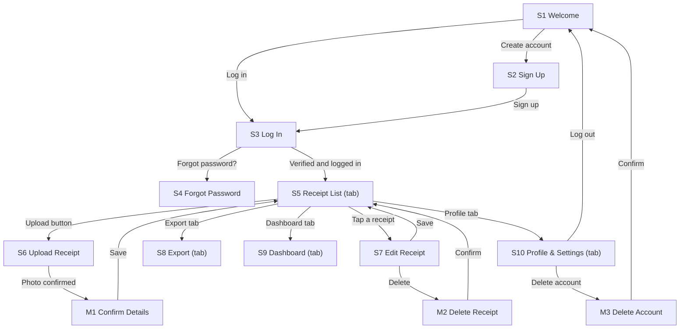

# SnapBooks — PRD v1.0

*Status: In review*

---

## Document details

| Field | Your answer |
|---|---|
| Product name | SnapBooks |
| Author(s) | Bheki, SNPL Cohort 2026 |
| Course code and cohort | SNPL Cohort 2026 |
| Facilitator / reviewer | None assigned |
| Link to original app idea | https://github.com/Paul280-cloud/snapbooks/blob/main/docs/idea.md |
| GitHub repository | https://github.com/Paul280-cloud/snapbooks |
| Version | v1.0 |
| Status | In review |

---

## Change log

| Version | Date | Section(s) changed | What changed | Regenerated? |
|---|---|---|---|---|
| v0.1 | 27 Oct 2026 | All | First draft | None |
| v1.0 | 28 Oct 2026 | All | All sections completed; status set to In review | None |

---

## 1. Product overview

### 1.1 Product name
SnapBooks

### 1.2 One-line pitch
SnapBooks helps small SA business owners to snap and file their receipts so that tax season stops being a nightmare.

### 1.3 Problem statement
Small business owners in SA — spaza shops, market traders, freelancers — lose receipts all the time. Without a record, they can't claim expenses or prove income at tax time. SARS requires supporting documents for 5 years, and every lost slip is money back that never gets claimed. The apps that exist are built for accountants and cost hundreds of rands per month.

### 1.4 Solution
Users snap a photo of any receipt using their phone. The app reads the vendor, amount, date, and category automatically. Everything appears in a searchable list you can filter by month or category. At tax time, you export it all as a spreadsheet. No bookkeeping knowledge needed — just photos.

### 1.5 Platform
Web app (works in a browser). Desktop-first design at 1440px wide; the layout also works on a phone at 360px so users can snap receipts on the go.

### 1.6 Vision
To be the bookkeeping tool a spaza shop owner actually opens — not one their accountant forces them to use.

### 1.7 Key terms

| Term | Exact meaning in this app |
|---|---|
| Receipt | A single photo of a paper till-slip, with extracted vendor, amount, date and category. |
| Vendor | The business name printed on the receipt (e.g. "Pick n Pay"). |
| Amount | The total rand value charged, saved as a decimal with 2 places (e.g. R 149.00). |
| Category | The type of expense: Food, Stock, Fuel, Rent, or Other. |
| Export | A single .xlsx file containing all receipts for a chosen date range. |
| Tax year | The 12-month period SARS uses for tax assessment: 1 March to 28/29 February. |

---

## 2. Users, personas and roles

### 2.1 Primary user
Small business owners in South Africa aged 25–45: spaza shop operators, market traders, freelancers, food truck owners. Medium tech comfort — they use WhatsApp daily but have not used accounting software. Most use an Android phone on prepaid data; some also have a laptop at home. They work in English or a mix of English and an African language.

### 2.2 Secondary users
None in v1. An accountant view is a future feature.

### 2.3 Personas

| Field | Persona 1 | Persona 2 |
|---|---|---|
| Name and age | Zanele Dube, 32 | Mpho Sithole, 41 |
| Role | Owner | Owner |
| Occupation / situation | Market trader, Johannesburg | Freelance graphic designer, Cape Town |
| Device and connectivity | Android phone, prepaid data | Laptop (Chrome) + Android phone, home Wi-Fi |
| Tech comfort | Medium | Medium |
| Language(s) | English, isiZulu | English, Sesotho |
| Goal | Keep all receipts in one place so she can show SARS what she spent | Export a clean spreadsheet for his accountant every February |
| Frustrations today | Receipts get wet, torn or lost in her bag; no time to type them in | Spends 3 hours manually totalling slips at tax time every year |
| How the app helps | Snaps a receipt in 10 seconds; the app reads vendor, amount and date | One tap exports everything already organised by category |
| Quote | "I just need to take a photo and forget about it." | "I don't want to learn software. I want a file I can email." |

### 2.4 Roles and permissions

| Role | How someone gets this role | Can do | Cannot do |
|---|---|---|---|
| Owner | Signs up and verifies email | Upload receipts; edit and delete own receipts; view and filter own receipt list; export own data; edit profile; delete account | See another owner's receipts (enforced by database Row-Level Security) |

### 2.5 Admin
Admin work is done directly in the Supabase dashboard. There are no admin screens in v1.

---

## 3. Goals, success metrics and non-goals

### 3.1 Goals

| # | Goal | Metric | Target | How you will check it |
|---|---|---|---|---|
| G1 | New users capture their first receipt quickly | % of new users who upload at least 1 receipt within 10 minutes of signing up | 70% | Receipt table: compare first created_at per user with User.created_at |
| G2 | Users keep coming back | % of users who upload at least 1 receipt in week 2 | 40% | Receipt table: count uploads per user in days 8–14 |
| G3 | The app is easy to use without training | Average usability rating from a test group | 4 out of 5 from 8 classmates after a 10-minute test | Google Form after testing |
| G4 | Tax export works reliably | % of export attempts that produce a valid, downloadable file | 100% in testing | Manual test: run export for each test account and open the file |

### 3.2 Non-goals

| What | Why not in v1 |
|---|---|
| Automatic OCR with no human correction | Too complex and unreliable for an MVP; users confirm all extracted values |
| Invoicing or quoting | A different product; out of scope |
| Accountant login or multi-user access | Adds role complexity; v1 is single-user only |
| Bank transaction import | Requires banking API integration; future feature |
| Native mobile app (iOS or Android) | Web app is faster to build and easier to demo |
| Income tracking | v1 tracks expenses only; income is a future feature |

---

## 4. Features, business rules and notifications

### 4.1 Feature list

| ID | Feature name | What the user can do | Priority | Goal | Stories | Screens |
|---|---|---|---|---|---|---|
| F1 | Account | Sign up, verify email, log in, reset password, log out, delete account | Must | G1 | US1, US2 | S1, S2, S3, S4, S10, M3 |
| F2 | Upload receipt | Upload a photo; app pre-fills vendor, amount, date, category; user confirms or edits; receipt is saved | Must | G1 | US3 | S5, S6, M1 |
| F3 | Receipt list | View all receipts newest first; filter by month, category or search by vendor name | Must | G2 | US4 | S5 |
| F4 | Edit and delete receipt | Edit any field on a saved receipt; delete a receipt with confirmation | Must | G2 | US5, US6 | S7, M2 |
| F5 | Export | Choose a date range and export all matching receipts as a .xlsx file | Must | G4 | US7 | S8 |
| F6 | Dashboard summary | See total spend by category and by month as bar charts | Should | G3 | US8 | S9 |

### 4.2 MVP definition
A user can sign up, upload a receipt photo, confirm the extracted details, view their receipt list filtered by month or category, and export everything as a spreadsheet.

### 4.3 Future features
- Income tracking and profit/loss summary
- Accountant share link (read-only export URL)
- Bank transaction import (Capitec, FNB)
- Recurring expense reminders
- Native mobile app (React Native)

### 4.4 Business rules

| ID | Rule | Used by |
|---|---|---|
| BR1 | A receipt must have a vendor (1–100 characters), an amount greater than R0.00 and no more than R999 999.99, a date not in the future, and a category from the fixed list. All four fields are required before a receipt can be saved. | F2, F4, S6, S7, M1 |
| BR2 | The category list is fixed in v1: Food, Stock, Fuel, Rent, Other. No custom categories. | F2, F3, F4, F6 |
| BR3 | Receipt photos must be JPG, PNG or WebP and under 10 MB. | F2, S6 |
| BR4 | A user can store at most 500 receipts per account in v1. When the limit is reached, the upload button is disabled and the message "You've reached the 500-receipt limit for this account." is shown. | F2, S5 |
| BR5 | Export produces one .xlsx file. Each row is one receipt: Date, Vendor, Category, Amount (ZAR). Rows are sorted by date, oldest first. Only receipts in the chosen date range are included. The file is named SnapBooks_export_YYYY-MM-DD.xlsx using today's date. | F5, S8 |
| BR6 | Receipts are deleted only when the user explicitly deletes them or deletes their account. The app must not auto-delete receipts. SARS requires supporting documents for 5 years. | F4, S7 |
| BR7 | Amounts are stored and displayed in ZAR as a decimal with exactly 2 places (e.g. R 149.00). The app does not accept negative amounts or non-numeric input. | F2, F4, BR1 |

### 4.5 Notifications
None in v1. All verification and password-reset emails are described in Section 5.

---

## 5. Accounts and sign-in

| Decision | Answer |
|---|---|
| Sign-up methods | Email + password only |
| Who may sign up | Anyone with an email address |
| Minimum age | 18. Sign Up has the checkbox "I am 18 or older", which must be ticked before "Sign up" is enabled. |
| Email verification | Required. After sign-up the user is taken to S3 Log In with the banner "Check your email and click the link to verify your account." Login is refused until verified. |
| Password rules | At least 8 characters, including at least 1 number. Eye icon to show or hide. |
| Forgot password | S4 Forgot Password sends a reset link. The link works for 1 hour. |
| Failed log-in attempts | After 5 wrong passwords: "Too many attempts. Try again in 15 minutes." |
| Stay logged in | 30 days, then the user must log in again. |
| Log out | S10 Profile → "Log out". No confirmation. |
| Delete account | S10 Profile → "Delete account" → M3 confirm. Immediately and permanently deletes the profile, all receipts and all uploaded photos. |
| Change email | Not in v1. |

---

## 6. User stories, acceptance criteria and edge cases

### 6.1 Stories

**US1 — Account creation (F1)**
As a new user, I want to create an account so that I can start saving receipts.

- T-US1-1: Given I am on S2 Sign Up, when I enter a valid email, a password of 8+ characters with 1 number, tick "I am 18 or older" and "I agree to the Privacy Notice", and tap "Sign up", then my account is created and I go to S3 Log In with the banner "Check your email to verify your account."
- T-US1-2 (unhappy): Given the email already has an account, when I tap "Sign up", then I see "This email already has an account. Log in instead?" with a "Log in" link.
- T-US1-3 (unhappy): Given either checkbox is unticked or the password is shorter than 8 characters, then "Sign up" is greyed out and the password field shows "At least 8 characters, including a number."

**US2 — Log in and reset password (F1)**
As a registered user, I want to log in and reset my password so that I can access my account.

- T-US2-1: Given my email is verified, when I enter the correct email and password on S3 and tap "Log in", then I go to S5 Receipt List.
- T-US2-2 (unhappy): Given I have not verified my email, when I tap "Log in", then I see "Please verify your email first." with a "Resend email" link.
- T-US2-3: Given I tap "Forgot password?" and enter my email on S4, when I tap "Send link", then I always see "If an account exists for this email, we've sent a reset link." (Never reveals whether the account exists.)

**US3 — Upload a receipt (F2)**
As a logged-in user, I want to upload a photo of a receipt so that I have a digital record.

- T-US3-1: Given I am on S5, when I tap "Upload" and pick a JPG, PNG or WebP under 10 MB, then I see the photo on S6 with fields for Vendor, Amount, Date, and Category pre-filled where the app can read them.
- T-US3-2 (unhappy): Given the file is larger than 10 MB or not a JPG, PNG or WebP, when I pick it, then I see "This file can't be used. Choose a JPG, PNG or WebP under 10 MB."
- T-US3-3 (unhappy): Given I lose internet during upload, then I see "Upload failed. Check your connection." with "Try again", and my photo is kept on S6.
- T-US3-4: Given I confirm the details on M1, when I tap "Save", then the receipt appears at the top of S5 with a toast "Receipt saved."

**US4 — View and filter receipts (F3)**
As a user, I want to see and filter my receipts so that I can find things quickly.

- T-US4-1: Given I have receipts on S5, when I scroll, then I see them newest first, 20 at a time. The next 20 load when I reach the bottom.
- T-US4-2: Given I type in the search bar or pick a category filter, then the list updates to show only matching receipts.
- T-US4-3 (unhappy): Given I have no receipts, then I see "No receipts yet. Tap Upload to add your first receipt." with an "Upload" button.

**US5 — Edit a receipt (F4)**
As a user, I want to edit a receipt so that I can correct mistakes.

- T-US5-1: Given I tap a receipt on S5, when I edit Vendor, Amount, Date, or Category on S7 and tap "Save", then the updated values appear on S5 with a toast "Receipt updated."
- T-US5-2 (unhappy): Given the amount is empty or contains letters, then "Save" is greyed out and the field shows "Enter a rand amount, e.g. 89.99."

**US6 — Delete a receipt (F4)**
As a user, I want to delete a receipt so that I can remove mistakes.

- T-US6-1: Given I am on S7, when I tap "Delete" and confirm in M2, then the receipt is removed from S5 with a toast "Receipt deleted."
- T-US6-2 (unhappy): Given the delete request fails due to no internet, then I see "Couldn't delete. Check your connection." and the receipt stays in the list.

**US7 — Export receipts (F5)**
As a user, I want to export my receipts as a spreadsheet so that I can give it to my accountant or SARS.

- T-US7-1: Given I am on S8 and choose a date range, when I tap "Export", then a .xlsx file downloads with columns: Date, Vendor, Category, Amount — rows sorted oldest first (BR5).
- T-US7-2 (unhappy): Given no receipts exist in the chosen range, then I see "No receipts in that range. Adjust the dates and try again."

**US8 — Dashboard summary (F6)**
As a user, I want to see my spending by category so that I know where my money goes.

- T-US8-1: Given I have at least 1 receipt, when I open S9 Dashboard, then I see a bar chart of total spend per category and a bar chart of total spend per month for the current tax year.
- T-US8-2 (unhappy): Given I have no receipts, then I see "No data yet. Upload receipts to see your spending summary."

### 6.2 Edge cases

| Situation | What the user sees | What the app does |
|---|---|---|
| Receipt is deleted while I am viewing it on S7 | "This receipt is no longer available." | Returns the user to S5 |
| I upload a photo while offline | "You're offline. Receipts can't be saved without a connection." | Nothing is uploaded or saved |
| Two devices upload receipts at the same time | Both save successfully; both appear on next refresh | Each gets a unique ID from the database |
| My login expires while I am editing a receipt on S7 | "Please log in again." | User taken to S3; unsaved edits are lost |
| I upload a photo that is not a receipt (e.g. a selfie) | "We couldn't read a receipt from that photo. Enter the details manually." | Photo kept on S6; all fields blank for manual entry |
| I reach the 500-receipt limit (BR4) | "You've reached the 500-receipt limit for this account." | Upload button disabled; existing receipts unaffected |

---

## 7. User flows and navigation map

### 7.1 Flows

**Flow 1: Sign up and upload first receipt (F1, F2)**
Starts when: Zanele opens the app for the first time.

1. S1 Welcome: taps "Create account" → S2 Sign Up
2. S2: fills in email, password, ticks both checkboxes, taps "Sign up" → S3 with verify-email banner
3. Clicks the link in her email, returns to the app, logs in on S3 → S5 Receipt List
4. S5: taps "Upload" → S6 Upload Receipt
5. S6: picks a photo; app pre-fills vendor, amount, date, category
6. If file is wrong format or too large → error stays on S6; otherwise → M1 Confirm Details
7. M1: checks and edits fields, taps "Save" → S5 with toast "Receipt saved."

Ends when: The receipt appears at the top of S5.

---

**Flow 2: Filter and find a receipt (F3)**
Starts when: Zanele wants to find all her Fuel receipts from March.

1. S5: selects "Fuel" from the category filter dropdown, or types in the search bar
2. The list updates immediately to show only matching receipts
3. If no matches → "No receipts match that filter. Clear filters to see all." + "Clear filters" link
4. If matches found → matching receipts displayed

Ends when: Zanele sees the receipts she was looking for.

---

**Flow 3: Export for tax (F5)**
Starts when: Mpho wants to send all his receipts to his accountant.

1. Tab bar: taps "Export" → S8
2. S8: picks start date (1 March 2025) and end date (28 February 2026), taps "Export"
3. If no receipts in range → "No receipts in that range. Adjust the dates and try again."
4. If receipts found → .xlsx file downloads; toast "Export ready."

Ends when: The file is on Mpho's device.

---

**Flow 4: Edit and delete a receipt (F4)**
Starts when: Zanele realises she typed the wrong amount.

1. S5: taps the receipt card → S7 Edit Receipt
2. S7: edits the Amount field, taps "Save" → S5 with toast "Receipt updated."
3. Alternatively: taps "Delete" → M2 confirm → taps "Yes, delete" → S5 with toast "Receipt deleted."

Ends when: The corrected or removed receipt is reflected on S5.

---

**Flow 5: Delete account (F1)**
Starts when: A user wants to permanently remove their account.

1. Tab bar: taps "Profile" → S10
2. S10: taps "Delete account" → M3 confirm
3. M3: taps "Yes, delete my account" → account, receipts and photos deleted → S1 Welcome

Ends when: The user is on S1 and the account no longer exists.

### 7.2 Navigation map

Tab bar shown on: S5, S8, S9, S10.
Tab bar hidden on: S1, S2, S3, S4, S6, S7, M1, M2, M3.

---

## 8. Screens

### 8.1 Screen inventory

Standard screens checked:
- Welcome ✓ S1
- Sign Up ✓ S2
- Log In ✓ S3
- Forgot Password ✓ S4
- Onboarding — not needed; receipt list is immediately useful after log-in.
- Home ✓ S5 (Receipt List)
- Profile and settings ✓ S10

| ID | Screen name | Type | Who can open it | Purpose | Tab bar? | Stories |
|---|---|---|---|---|---|---|
| S1 | Welcome | Full screen | Logged out | App pitch; sign up and log in buttons | No | US1, US2 |
| S2 | Sign Up | Full screen | Logged out | Create an account | No | US1 |
| S3 | Log In | Full screen | Logged out | Log in; verify-email banner after sign-up | No | US2 |
| S4 | Forgot Password | Full screen | Logged out | Request a password reset link | No | US2 |
| S5 | Receipt List | Tab | Logged in: Owner | View, search and filter all receipts; upload button | Yes | US3, US4, US5, US6 |
| S6 | Upload Receipt | Full screen | Logged in: Owner | Review and edit pre-filled receipt fields before confirming | No | US3 |
| S7 | Edit Receipt | Full screen | Logged in: Owner | Edit or delete a saved receipt | No | US5, US6 |
| S8 | Export | Tab | Logged in: Owner | Choose a date range and download .xlsx | Yes | US7 |
| S9 | Dashboard | Tab | Logged in: Owner | Spend by category and month as bar charts | Yes | US8 |
| S10 | Profile & Settings | Tab | Logged in: Owner | Edit name; log out; delete account; Privacy Notice link | Yes | US1 |
| M1 | Confirm Receipt Details | Modal | Logged in: Owner | Review extracted fields before saving | — | US3 |
| M2 | Delete Receipt | Modal | Logged in: Owner | Confirm permanent deletion of one receipt | — | US6 |
| M3 | Delete Account | Modal | Logged in: Owner | Confirm permanent deletion of account and all data | — | US1 |

### 8.2 Screen specifications

---

**S1 Welcome**
Purpose: Introduce the app and direct the user to sign up or log in.
Who can open it: Logged out.
Comes from / goes to: App launch → S1 → S2 or S3.

Layout:
1. SnapBooks logo and wordmark, centred
2. Tagline: "Snap receipts. Survive tax season."
3. Primary button: "Create account" → S2
4. Secondary link: "Log in" → S3

States: Normal only. Sample content: Static screen.

---

**S2 Sign Up**
Purpose: Create a new account.
Who can open it: Logged out.
Comes from / goes to: S1 → S2 → S3.

Layout:
1. Header: back arrow, title "Create account"
2. Email field
3. Password field (show/hide eye icon)
4. Checkbox: "I am 18 or older" (unticked by default)
5. Checkbox: "I agree to the Privacy Notice" with link (unticked by default)
6. Primary button: "Sign up" (greyed out until both checkboxes ticked and password valid)
7. Link: "Already have an account? Log in" → S3

Form fields:

| Label | Type | Required? | Placeholder | Rules | Error message |
|---|---|---|---|---|---|
| Email | Email | Yes | your@email.com | Valid email format | "Enter a valid email address." |
| Password | Password | Yes | At least 8 characters | Min 8 chars, 1 number | "At least 8 characters, including a number." |

States: Normal · Error (red border + message) · Loading (spinner on button) · Success (→ S3 with banner).
Sample content: Static screen.

---

**S3 Log In**
Purpose: Log in to an existing account.
Who can open it: Logged out.
Comes from / goes to: S1, S2, session expiry → S3 → S5 or S4.

Layout:
1. Header: title "Log in"
2. Info banner (shown only after sign-up): "Check your email and click the link to verify your account."
3. Email field
4. Password field (show/hide eye icon)
5. Link: "Forgot password?" → S4
6. Primary button: "Log in" → S5
7. Link: "Don't have an account? Sign up" → S2

States: Normal · Error ("Incorrect email or password.") · Locked ("Too many attempts. Try again in 15 minutes.") · Unverified ("Please verify your email first." + "Resend email" link).
Sample content: Static screen.

---

**S4 Forgot Password**
Purpose: Request a password reset link.
Who can open it: Logged out.
Comes from / goes to: S3 → S4 → stays on S4 with confirmation.

Layout:
1. Header: back arrow, title "Forgot password"
2. Email field
3. Primary button: "Send link"
4. After tap: "If an account exists for this email, we've sent a reset link."

Sample content: Static screen.

---

**S5 Receipt List**
Purpose: The home screen. View, search and filter all saved receipts. Upload a new one.
Who can open it: Logged in: Owner.
Comes from / goes to: S3, M1, S7, M2 → S5 → S6, S7, S8, S9, S10.

Layout:
1. Header: SnapBooks wordmark left; receipt count right (e.g. "47 receipts")
2. Search bar: placeholder "Search by vendor…"
3. Filter row: category dropdown (All, Food, Stock, Fuel, Rent, Other); month/year picker
4. Primary button: "+ Upload receipt" (disabled with message if BR4 reached)
5. Receipt list: scrolling list of Receipt cards, newest first, 20 at a time
6. Tab bar

Receipt card (in order): category colour dot · vendor name (bold) · date (e.g. 12 Mar 2026) · amount right-aligned (e.g. R 149.00) · category label.

States:
- Normal: receipt cards as above.
- Empty: "No receipts yet. Tap Upload to add your first receipt." + "Upload" button.
- Filtered empty: "No receipts match that filter. Clear filters to see all." + "Clear filters" link.
- Loading: 3 grey placeholder cards.
- Loading more: spinner under the last card.
- Error: "Something went wrong. Try again." + "Try again" button.
- Offline: offline banner; upload button disabled.
- Limit reached (BR4): upload disabled + "You've reached the 500-receipt limit for this account."

Sample content:
- Pick n Pay · 12 Mar 2026 · R 320.00 · Stock
- BP Fuels · 8 Mar 2026 · R 780.00 · Fuel
- Shoprite · 1 Mar 2026 · R 215.50 · Food

---

**S6 Upload Receipt**
Purpose: Show the uploaded photo and pre-filled fields; let the user correct them before saving.
Who can open it: Logged in: Owner.
Comes from / goes to: S5 → S6 → M1 or S5 (cancel).

Layout:
1. Header: back arrow (cancel → S5), title "Upload receipt"
2. Photo preview (full width, max 300px tall)
3. Form fields: Vendor, Amount, Date, Category
4. Primary button: "Review and save" → M1

Form fields:

| Label | Type | Required? | Placeholder | Rules | Error message |
|---|---|---|---|---|---|
| Vendor | Text | Yes | e.g. Pick n Pay | 1–100 characters (BR1) | "Enter a vendor name." |
| Amount | Number | Yes | e.g. 149.00 | > 0, ≤ 999 999.99, 2 dp (BR7) | "Enter a rand amount, e.g. 89.99." |
| Date | Date | Yes | DD/MM/YYYY | Not in the future (BR1) | "Enter a date that is not in the future." |
| Category | Dropdown | Yes | Select a category | Food, Stock, Fuel, Rent, Other (BR2) | "Select a category." |

States: Normal (pre-filled) · Manual (couldn't read — all fields blank, tip shown) · Error · Uploading (spinner) · Offline (upload disabled).
Sample content: Zanele's Pick n Pay slip · Vendor: Pick n Pay · Amount: R 320.00 · Date: 12 Mar 2026 · Category: Stock.

---

**S7 Edit Receipt**
Purpose: Edit or delete a saved receipt.
Who can open it: Logged in: Owner.
Comes from / goes to: S5 → S7 → S5.

Layout:
1. Header: back arrow (cancel), title "Edit receipt"
2. Photo preview
3. Same four form fields as S6, pre-filled with saved values
4. Primary button: "Save" → S5
5. Danger button: "Delete receipt" → M2

States: Same as S6, plus Saving (spinner) and Success (→ S5 with toast "Receipt updated.").
Sample content: Zanele editing BP Fuels receipt — changing R 780.00 to R 790.00.

---

**S8 Export**
Purpose: Choose a date range and download all matching receipts as .xlsx.
Who can open it: Logged in: Owner.
Comes from / goes to: Tab bar → S8.

Layout:
1. Header: title "Export"
2. Date range: Start date field + End date field (default: current tax year)
3. Summary line: "23 receipts found in this range."
4. Primary button: "Export to spreadsheet" (BR5)
5. Note: "File format: .xlsx · Columns: Date, Vendor, Category, Amount · Sorted oldest first"
6. Tab bar

States: Normal (receipts found) · Empty range ("No receipts in that range. Adjust the dates and try again.") · Exporting (spinner) · Success (toast "Export ready." + file downloads) · Offline (button disabled + banner).
Sample content: Start 1 Mar 2025 · End 28 Feb 2026 · 23 receipts found.

---

**S9 Dashboard**
Purpose: See total spend by category and by month as bar charts.
Who can open it: Logged in: Owner.
Comes from / goes to: Tab bar → S9.

Layout:
1. Header: title "Dashboard"
2. Tax year label: "1 Mar 2025 – 28 Feb 2026"
3. Bar chart: total spend per category
4. Bar chart: total spend per month
5. Total: "Total expenses: R 14 350.00"
6. Tab bar

States: Normal (charts with data) · Empty ("No data yet. Upload receipts to see your spending summary.") · Loading (grey placeholder bars).
Sample content: Stock R 6 400.00 · Fuel R 3 120.00 · Food R 2 830.00 · Other R 1 200.00 · Rent R 800.00.

---

**S10 Profile & Settings**
Purpose: View account info, log out, delete account, access the Privacy Notice.
Who can open it: Logged in: Owner.
Comes from / goes to: Tab bar → S10 → S1.

Layout:
1. Header: title "Profile"
2. Display name and email (read-only in v1)
3. Link: "Privacy Notice"
4. Secondary button: "Log out" → S1
5. Danger button: "Delete account" → M3
6. Tab bar

States: Normal only.
Sample content: Zanele Dube · zanele.d@example.com.

---

**M1 Confirm Receipt Details**
Purpose: Final check before saving.
Who can open it: Logged in: Owner (from S6).
Comes from / goes to: S6 → M1 → S5 or S6.

Layout:
1. Title: "Confirm receipt"
2. Read-only summary: Vendor · Date · Amount · Category
3. Secondary button: "Edit" → S6
4. Primary button: "Save" → S5 with toast "Receipt saved."

---

**M2 Delete Receipt**
Purpose: Confirm permanent deletion of one receipt.
Who can open it: Logged in: Owner (from S7).
Comes from / goes to: S7 → M2 → S5 or S7.

Layout:
1. Title: "Delete receipt?"
2. Message: "This will permanently remove this receipt. This cannot be undone."
3. Secondary button: "Cancel" → S7
4. Danger button: "Yes, delete" → S5 with toast "Receipt deleted."

---

**M3 Delete Account**
Purpose: Confirm permanent deletion of the account and all data.
Who can open it: Logged in: Owner (from S10).
Comes from / goes to: S10 → M3 → S1 or S10.

Layout:
1. Title: "Delete your account?"
2. Message: "This will permanently delete your account, all receipts, and all uploaded photos. This cannot be undone."
3. Secondary button: "Cancel" → S10
4. Danger button: "Yes, delete my account" → S1

---

### 8.3 Shared components

| Component | Used on | What it contains | How it behaves |
|---|---|---|---|
| Header | S2–S10 | Back arrow (where applicable), page title | Back arrow returns to previous screen |
| Tab bar | S5, S8, S9, S10 | 4 tabs: Receipts, Export, Dashboard, Profile (Lucide icons) | Active tab uses primary colour; hidden on all other screens |
| Primary button | All screens | Label, full width, 48px tall | Greyed out when disabled |
| Secondary button | S7, M1, M2, M3 | Label, full width, 48px tall, outlined | Normal border colour |
| Danger button | S7, S10 | Label, full width, 48px tall | Red background, white text |
| Receipt card | S5 | Category dot, vendor (bold), date, amount (right-aligned), category label | Tap → S7 |
| Toast | S5, S8 | One line, dark background, white text | Disappears after 3 seconds |
| Offline banner | All logged-in screens | "You're offline. Changes will not be saved." | Appears at top; save actions disabled |
| Empty-state block | S5, S8, S9 | Line illustration, message, optional button | Centred; used when no data |
| Loading placeholder | S5, S9 | Grey placeholder cards or bars | Shown while data loads |

### 8.4 Sample data set

- **zanele.d@example.com** (Zanele Dube): 14 receipts. Mostly Stock and Fuel.
- **mpho.s@example.com** (Mpho Sithole): 9 receipts. Mostly Fuel and Other.
- **thabo.m@example.com** (Thabo Mokoena): 1 receipt. Use to test near-empty states.
- **ayesha.p@example.com** (Ayesha Patel): 0 receipts. Use to test all empty states.

Sample receipts (Zanele):
1. Pick n Pay · 12 Mar 2026 · R 320.00 · Stock
2. BP Fuels · 8 Mar 2026 · R 780.00 · Fuel
3. Shoprite · 1 Mar 2026 · R 215.50 · Food
4. Game Stores · 15 Feb 2026 · R 1 200.00 · Stock
5. Total Garage · 20 Jan 2026 · R 650.00 · Fuel

---

## 9. Design direction

### 9.1 Look and brand

| Item | Your choice |
|---|---|
| Look and feel | Clean, trustworthy, simple |
| Primary colour | Forest green #1B7F4F (white text on it passes 4.5:1 contrast) |
| Secondary / accent colour | Amber #F59E0B (chart highlights; Fuel category dot) |
| Background colour | #F9FAFB |
| Main text colour | #111827 |
| Secondary text colour | #6B7280 (passes 4.5:1 on #F9FAFB) |
| Error colour | #DC2626 |
| Success colour | #16A34A |
| Warning colour | #D97706 |
| Dark mode | No in v1 |
| Font | Inter (Google Fonts) |
| Text sizes | Title 24px bold · Heading 18px semibold · Body 16px regular · Small/label 13px regular |
| Spacing unit | 8px (gaps: 4, 8, 16, 24, 32px) |
| Screen side margin | 24px desktop; 16px mobile |
| Corner radius | Cards 8px · Inputs 6px · Buttons 6px |
| Shadows | Soft: 0 1px 3px rgba(0,0,0,0.1) on cards |
| Button height | 48px |
| Icon set | Lucide (outline) |
| Logo | Wordmark "SnapBooks" in Inter bold, primary green. Camera icon left of the text. |
| Images | Receipt photos uploaded by users only. Empty states use simple line illustrations. |
| Reference apps | Expensify (clean receipt list) · Google Sheets (familiar export) · Standard Bank app (trustworthy SA finance feel) |

### 9.2 Tone of voice
Direct, friendly, jargon-free. Examples: "Receipt saved!" not "Record successfully committed."; "No receipts yet." not "No entries found in the database."

### 9.3 Platform rules
- Under 640px (phone): single-column; tab bar at bottom; full-width buttons.
- 640–1024px (tablet): single-column; wider content area; 32px side margin.
- Over 1024px (desktop): two-column on S5 (filters left, receipt list right); max content width 1200px; top navigation bar.
- Every clickable element has a hover state (darken 10%) and keyboard-focus ring (2px primary colour outline).
- Design desktop first at 1440px; check mobile at 360px.

### 9.4 Accessibility
- Body text 16px minimum; small/label text 13px minimum.
- Every text/background pair checked at webaim.org/resources/contrastchecker for 4.5:1 minimum.
- Every tappable element at least 44×44px.
- Never colour alone to convey meaning — category dots also have a text label.
- Every icon-only button has an aria-label.
- File upload accepts keyboard interaction (Enter/Space opens the file picker).

---

## 10. Data model

### 10.1 Entities and fields

**Entity: User** — one person with an account.

| Field | Type | Required? | Default | Unique? | Rules | If linked record deleted |
|---|---|---|---|---|---|---|
| id | ID | Yes | Auto | Yes | Same as Supabase Auth user ID | — |
| email | Email | Yes | — | Yes | Managed by Supabase Auth; never shown to others | — |
| display_name | Text (60) | No | — | No | 1–60 characters | — |
| is_18_or_older | Yes/No | Yes | No | No | Must be Yes to sign up | — |
| created_at | Date-time | Yes | Now | No | — | — |

**Entity: Receipt** — one saved expense record.

| Field | Type | Required? | Default | Unique? | Rules | If linked record deleted |
|---|---|---|---|---|---|---|
| id | ID | Yes | Auto | Yes | — | — |
| owner_id | Link to User | Yes | Current user | No | — | Delete this receipt too |
| photo_url | Text (500) | Yes | — | No | URL to file in Supabase Storage | — |
| vendor | Text (100) | Yes | — | No | 1–100 characters (BR1) | — |
| amount | Decimal | Yes | — | No | > 0, ≤ 999 999.99, 2 dp (BR7) | — |
| date | Date | Yes | — | No | Not in the future (BR1) | — |
| category | Choice | Yes | — | No | Food, Stock, Fuel, Rent, Other (BR2) | — |
| created_at | Date-time | Yes | Now | No | — | — |
| updated_at | Date-time | Yes | Now | No | Updated on every edit | — |

### 10.2 Relationships
One User owns many Receipts. If a User is deleted, all their Receipts are deleted too.

### 10.3 Status values and changes
No status fields in v1. Receipts have no workflow state.

### 10.4 Reference and seed data

**Reference data:** The five category values are hard-coded in the app. No database table needed.

**Seed data:** The four users and sample receipts from Section 8.4 are loaded by a seed script in supabase/seed/.

**Test accounts:**

| Role | Email | Test-only password |
|---|---|---|
| Owner (with receipts) | zanele.d@example.com | Kept in seed script README only |
| Owner (empty) | ayesha.p@example.com | Kept in seed script README only |

---

## 11. Tech stack and architecture

### 11.1 Stack

| Layer | Choice | Why |
|---|---|---|
| Frontend | React + Vite | Fast setup; covered in the course |
| Styling | Tailwind CSS | Utility-first; matches Section 9 design tokens |
| Backend / API | Supabase | Auth, database and file storage in one service |
| Database | PostgreSQL (via Supabase) | Relational; Row-Level Security built in |
| Log-in | Supabase Auth | Email verification and password reset included |
| File / image storage | Supabase Storage ("receipts" bucket) | Stores uploaded receipt photos |
| Scheduled jobs | None in v1 | No timed actions needed |
| Export | SheetJS (xlsx, client-side) | Generates .xlsx in the browser; no server needed |
| Hosting | Vercel | Free tier; automatic deploys from GitHub |
| Language | TypeScript, npm, Node.js 20 LTS | Fewer type bugs |
| Testing | Jest for BR1, BR4, BR5, BR7; manual checklist for all T- criteria | Business rules are the highest risk |
| Version control | https://github.com/Paul280-cloud/snapbooks | Save PRD as docs/PRD.md and MASTER.md in root |

### 11.2 Third-party services

| Service | What it does | Free tier enough? | Needs a key? |
|---|---|---|---|
| Supabase | Auth, database, file storage | Yes | Yes — see 11.5 |
| Vercel | Hosting | Yes | No |
| SheetJS | Client-side .xlsx generation | Yes (open source) | No |

### 11.3 How the parts connect
The React app runs in the browser and talks to Supabase using the Supabase JavaScript client. All database queries go through Supabase's REST API with Row-Level Security enforcing that each user can only read and write their own receipts. Receipt photos are uploaded directly from the browser to Supabase Storage; the database stores only the file URL. The .xlsx export is generated entirely in the browser by SheetJS — no server call is needed for export.

### 11.4 Permissions

| Entity | Action | Who is allowed | Extra rule |
|---|---|---|---|
| User | Read | Owner only | Own row only |
| User | Update | Owner only | Own row only |
| User | Delete | Owner only | Cascades to all Receipts and Storage files |
| Receipt | Read | Owner only | owner_id = current user |
| Receipt | Create | Owner only | owner_id set to current user; max 500 per user (BR4) |
| Receipt | Update | Owner only | owner_id = current user |
| Receipt | Delete | Owner only | owner_id = current user |
| Storage "receipts" | Upload | Owner only | Inside a folder named with their user id |
| Storage "receipts" | Read | Owner only | Path must start with their user id |

### 11.5 Environment variables

| Name | What it is | Where to get it | Public or secret? |
|---|---|---|---|
| VITE_SUPABASE_URL | Project URL | Supabase dashboard → Project Settings | Public |
| VITE_SUPABASE_ANON_KEY | Public (anon) key | Same | Public — safe only because RLS is on |
| SUPABASE_SERVICE_ROLE_KEY | Admin key for seed script only | Same | Secret: never in the browser app |

### 11.6 Folder structure